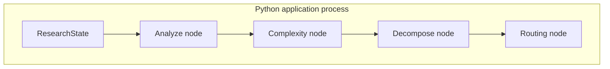
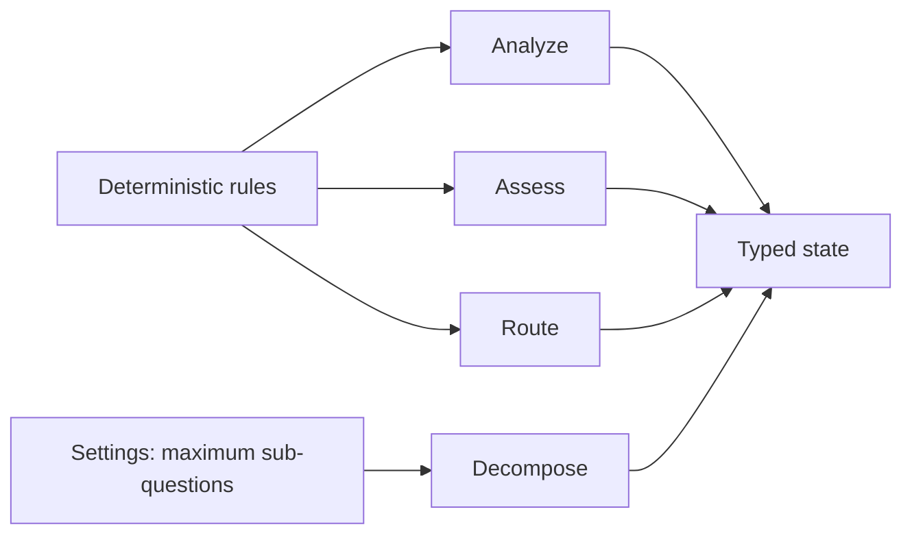
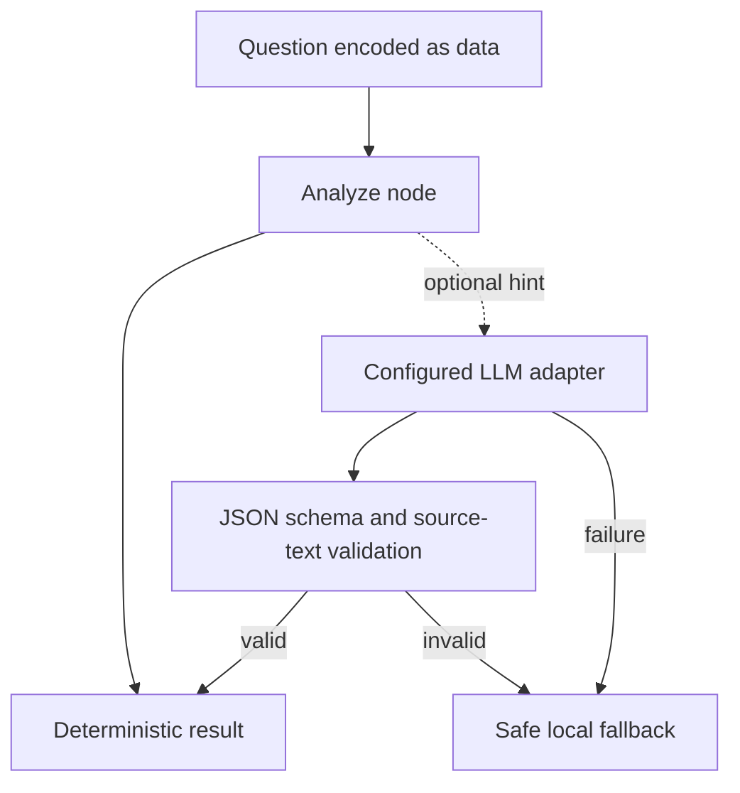
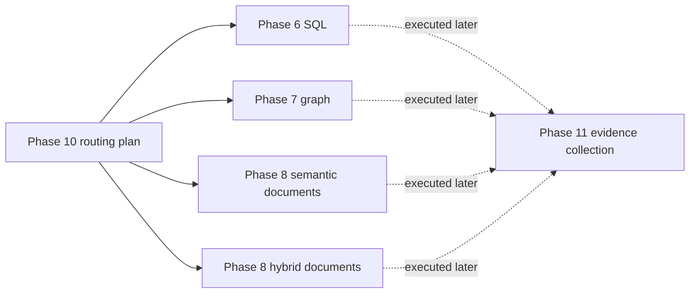
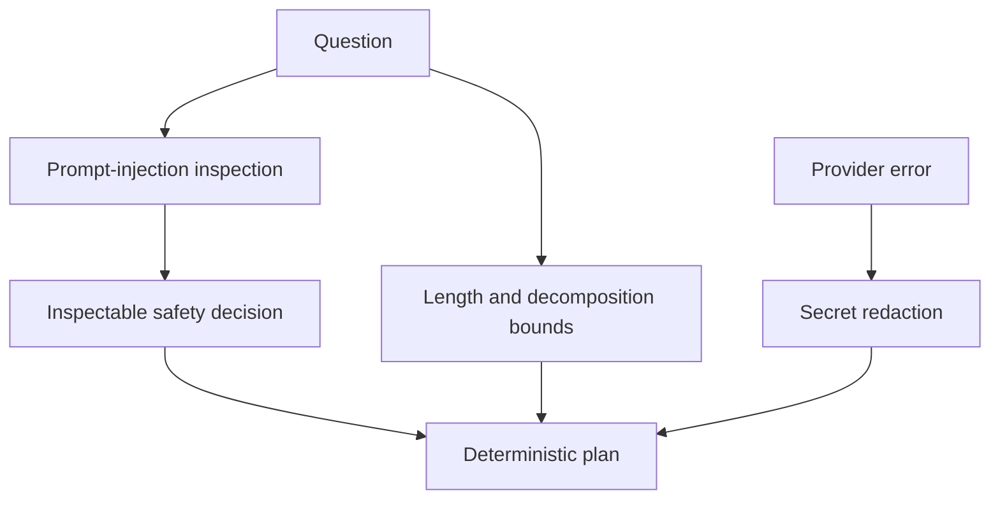

# Phase 10 — Infrastructure Design Evolution

## Default local wiring

Phase 10 adds no container or network dependency. All planning nodes run inside
the Python process using deterministic rules.

## Component wiring

Configuration controls only the safe bound. It does not change tenant data or
connect directly to retrieval stores.

## Optional provider route

The default fake provider returns no accepted hint, so offline behavior remains
deterministic. A real provider is optional and cannot introduce an entity or
time phrase absent from the original question.

## Future retrieval handoff

No database, Qdrant, or Neo4j call occurs during planning. The handoff is a
small typed plan, keeping infrastructure failures out of query classification.

## Failure and safety boundary

Phase 10 reports safe error metadata and continues with local rules. It neither
executes instructions embedded in the question nor opens a network connection
in the default test path.
