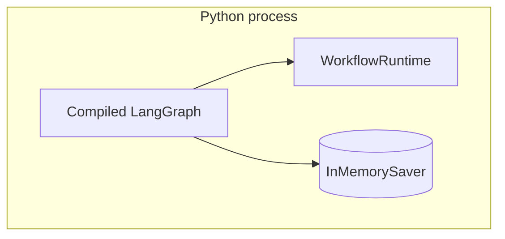
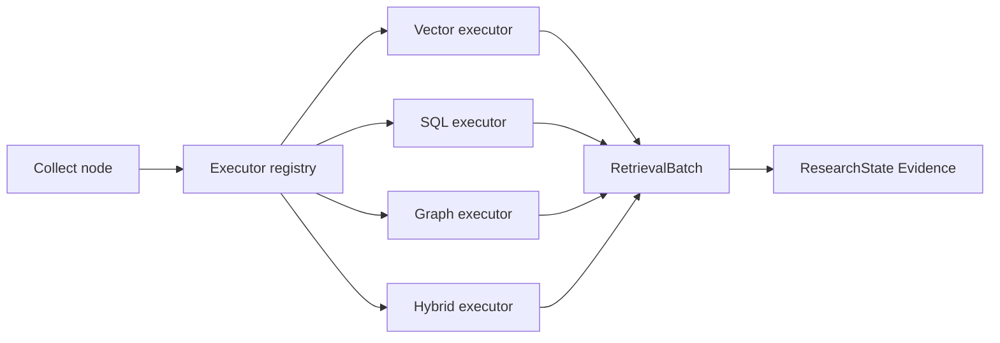
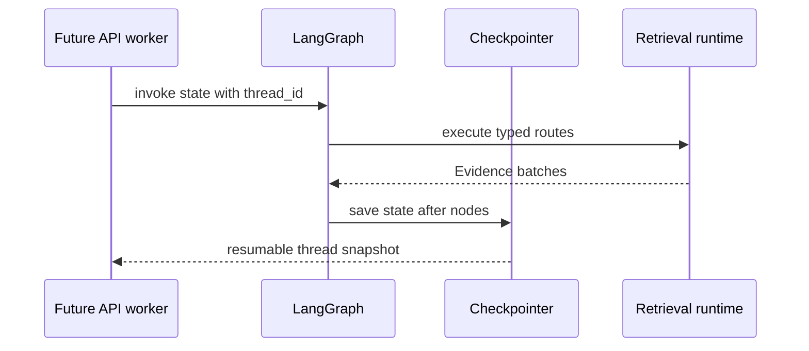
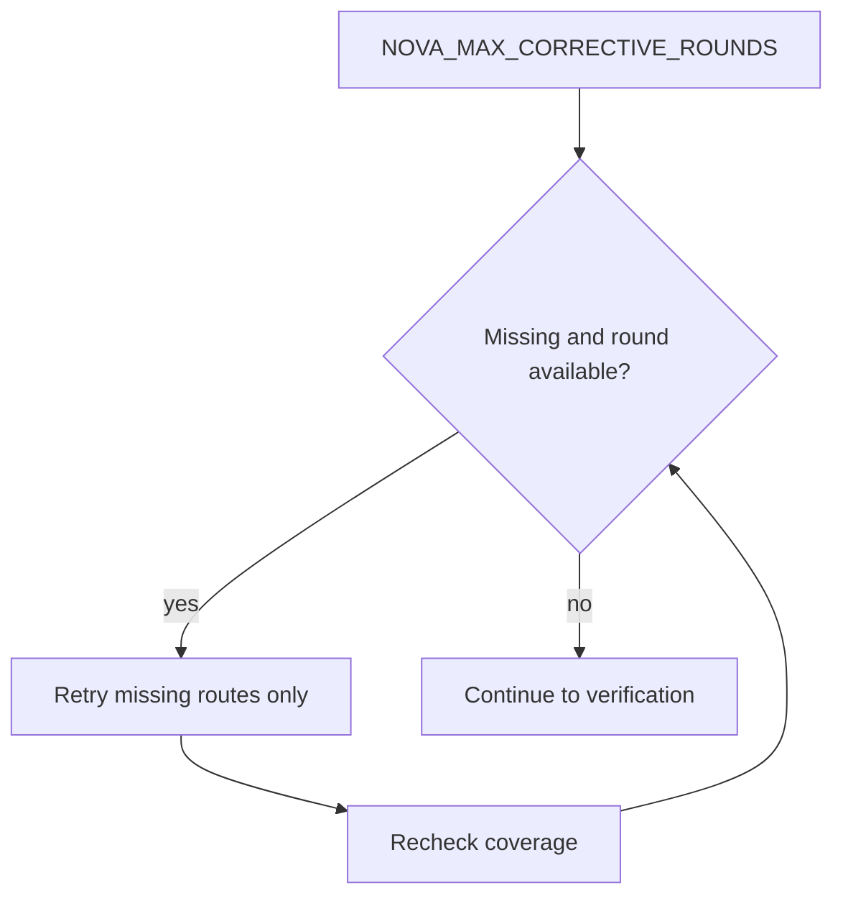
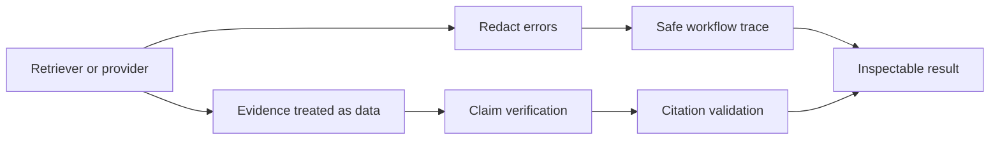

# Phase 11 — Infrastructure Design Evolution

## Default local wiring

Phase 11 runs inside the Python process. Tests use injected executors and
LangGraph's in-memory checkpointer, so no container or network is required.

## Retrieval component wiring

The runtime is an adapter boundary. Phase 12 can inject real tenant-scoped
retrievers; Phase 11 tests inject deterministic local functions.

## Checkpoint and routing flow

The local checkpointer lasts only for the process lifetime. A later production
deployment may replace it with a persistent LangGraph checkpointer without
changing the node contracts.

## Bounded correction wiring

The counter lives in validated state and the configured maximum is capped, so
an unavailable dependency cannot create infinite traffic or an agent loop.

## Failure and trust boundary

Phase 11 creates no SQL, Qdrant, Neo4j, Redis, or external-model connection by
itself. Those dependencies remain behind existing adapters and injected
executors.
