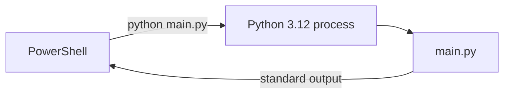
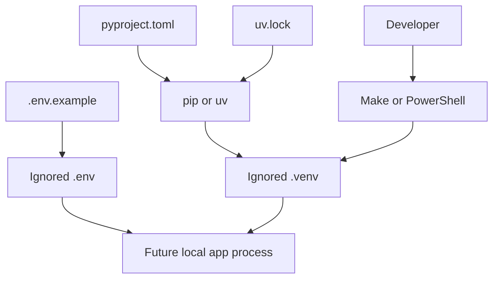
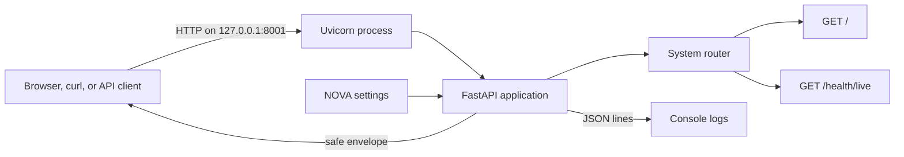
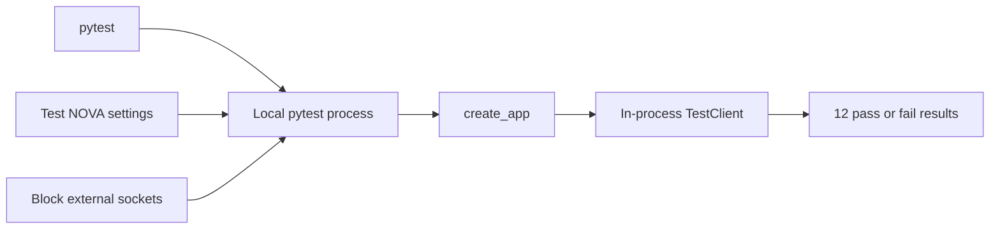
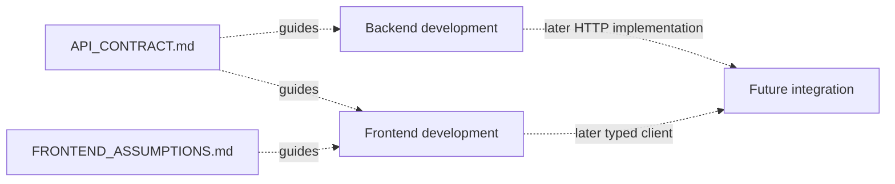
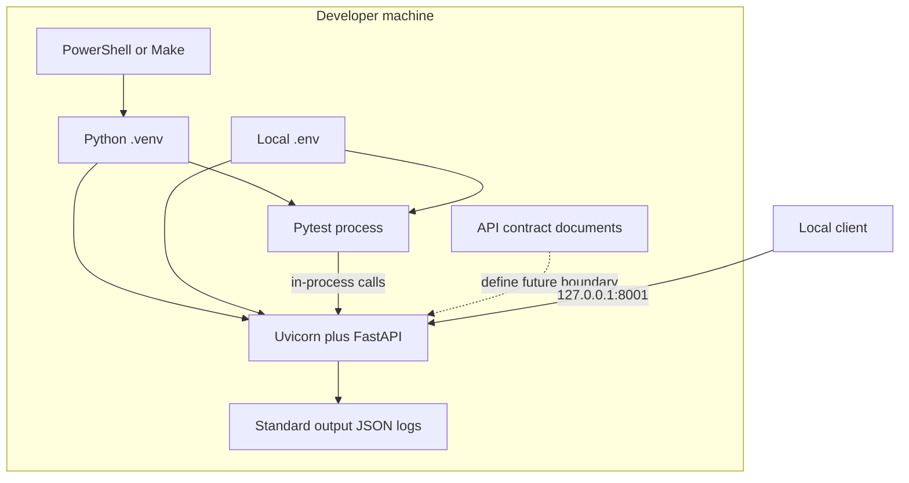
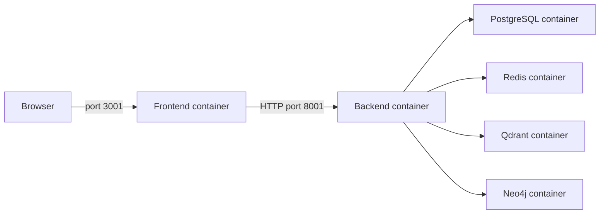

# Phase 1 Infrastructure Design Evolution

## Purpose

This document explains where Phase 1 code runs and how its components are wired.
Phase 1 uses local Python processes. It does not use Docker networking; container
images and Compose are deliberately deferred to Phase 16.

## Beginning of Phase 1 — one short-lived process

Originally, one command created one process, printed a greeting, and exited.

There was no network port, server, test runner, service discovery, or dependency
connection.

## P1-1 — local workspace wiring

Components:

- `.venv` isolates installed Python packages from the rest of the machine.
- `uv.lock` freezes dependency resolution.
- `.env` stays local and ignored; `.env.example` contains only safe defaults.
- Make and PowerShell commands start the same Python modules.

This is process setup, not container orchestration.

## P1-2 — local HTTP runtime

The backend now runs as a local Uvicorn/FastAPI process when started by a
developer.

Request routing:

1. Uvicorn listens on local port 8001.
2. FastAPI matches the request path and validates input.
3. The system route returns typed JSON.
4. Shared handlers convert failures into a stable public envelope.
5. Structured operational events go to standard output.

The service binds to `127.0.0.1` in the documented development command, so it is
not exposed to other machines by default.

## P1-3 — separate offline verification path

The test process does not contact port 8001. It calls the application in memory,
which makes the suite faster and avoids depending on server startup timing.
External network connections are blocked by the shared fixture.

## P1-4 — design-time routing

The contract documents connect teams, not running services.

Dotted arrows are documentation relationships. Phase 1 does not create a
frontend process or a cross-service network.

## End-of-Phase-1 topology

Infrastructure characteristics:

- one developer machine;
- isolated Python environment;
- optional local HTTP process;
- settings supplied locally;
- JSON logs written to standard output;
- tests using an in-memory client; and
- no database, broker, vector store, graph store, or container network.

## Docker networking status

There is currently no Dockerfile, Compose file, Docker network, container volume,
or container health check. That is intentional.

The following is a **Phase 16 preview**, not Phase 1 output:

Phase 16 must decide network names, internal versus published ports, volumes,
credentials, health checks, restart behavior, and startup dependencies. Phase 1
does not hide those decisions inside premature container files.

## Component and route table

| Component | Runs where | Receives | Produces |
|---|---|---|---|
| Uvicorn | Local Python process | Local TCP requests | ASGI calls |
| FastAPI app | Same process | ASGI request | Typed response or safe error |
| Settings | Same process | `NOVA_` environment values | Validated configuration |
| JSON logger | Same process | Python log records | JSON lines on stdout |
| Pytest | Separate local process | Tests and deterministic fixtures | Pass/fail results |
| TestClient | Inside pytest | In-memory HTTP-style calls | Responses without a socket |
| Contract documents | Git working tree | Reviewed design decisions | Shared team agreement |

## Operational and security choices

- Real secrets remain outside Git.
- The development server binds locally by default.
- Unexpected internal details are logged but not returned to clients.
- Tests cannot silently depend on the internet.
- Logs must not contain credentials or hidden model reasoning.
- Databases and services are added only by their planned phases.

## Interview-ready summary

Phase 1 evolved the infrastructure from one short-lived Python script into a
repeatable local web-service and verification environment. The runtime and tests
share the same application factory but use separate process paths. There is no
Docker network yet; Phase 1 first proves the application boundary locally, and
Phase 16 will package mature boundaries into containers deliberately.
