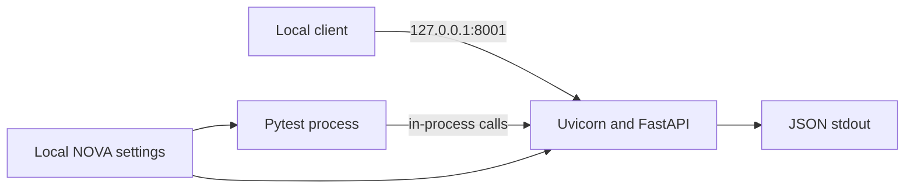
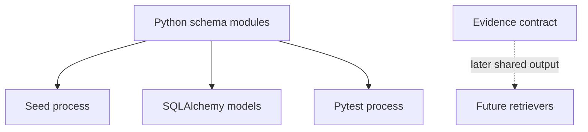
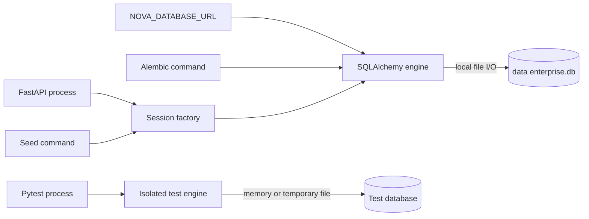
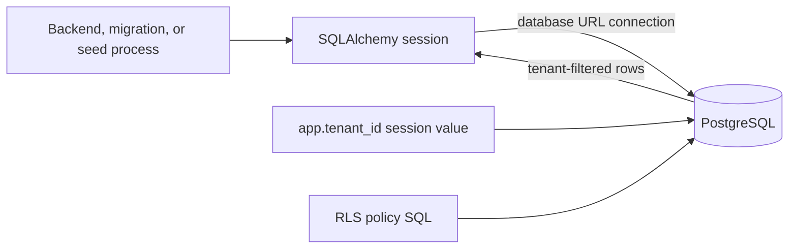
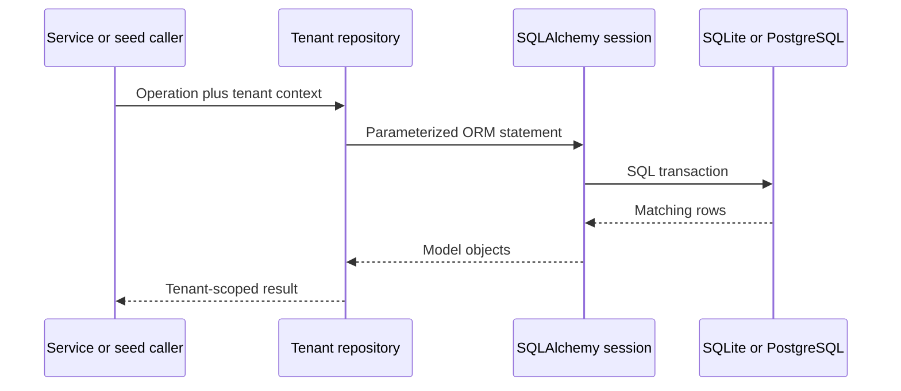
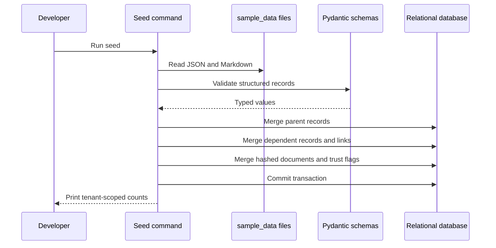
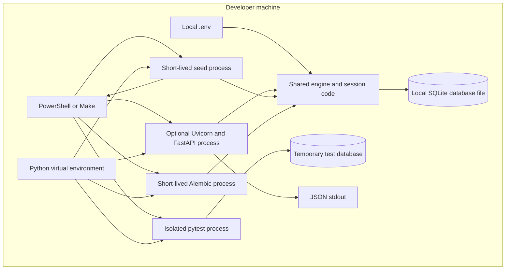
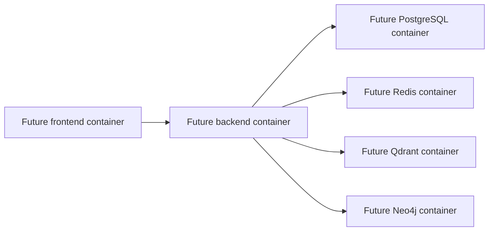

# Phase 2 Infrastructure Design Evolution

## Purpose

This document explains where Phase 2 persistence components run and how data is
wired between them. Phase 2 is still a local Python architecture by default. It
adds a SQLite database and a configurable production-style PostgreSQL path, but
it does not add Docker images, Compose networking, or remote services.

## Beginning of Phase 2 - stateless local processes

Phase 1 had two local execution paths: an optional Uvicorn/FastAPI process and a
separate offline pytest process. Neither used a database.

## P2-1 - contracts remain in process

Schemas and enums are Python objects imported by the seed service, models,
repositories, tests, and later API code. They add no port or external process.

This keeps validation close to every caller without creating a schema service
that would require network availability.

## P2-2 - local database wiring

The default Phase 2 topology adds one SQLite database file on the same developer
machine.

Component responsibilities:

| Component | Receives | Produces |
|---|---|---|
| Settings | `NOVA_DATABASE_URL` | Validated database location |
| Engine factory | Database URL | SQLAlchemy engine and SQLite FK enforcement |
| Session factory | Engine | Short-lived units of database work |
| Alembic | Revision and engine | Versioned schema changes |
| SQLite | Local SQL operations | Durable development records |
| Test engine | Test fixture configuration | Isolated deterministic state |

The web process does not expose the database file over a network. SQLite is
accessed through local file I/O. Sessions are opened for a unit of work and
closed afterward.

### Configured PostgreSQL path

The same application boundary can use a PostgreSQL URL in a future deployment:

The RLS artifact enables policies on all tenant-bearing Phase 2 tables. The
connection must set `app.tenant_id` for tenant-scoped operations. Applying that
artifact and managing a PostgreSQL server are deployment responsibilities, not
actions performed by the local SQLite workflow.

Important distinction:

- SQLite validates foreign keys and repositories add tenant filters;
- PostgreSQL can additionally enforce tenant filtering through row-level
  security; and
- Phase 2 does not claim SQLite has RLS or that a PostgreSQL server is already
  running.

## P2-3 - component routing through repositories

Repositories are in-process components, not network services. They receive an
already-open SQLAlchemy session and a tenant ID.

Routing rules:

1. API code is expected to call a service.
2. Services call repositories for persistence.
3. Repositories construct the ORM queries and apply tenant scope.
4. The session controls the transaction and database connection.
5. Models return to the caller through the repository boundary.

Phase 2 supplies repositories but does not yet wire them into new public API
routes. The existing root and liveness routes keep their Phase 1 behavior.

## P2-4 - seed command wiring

The seed command is a short-lived Python process.

Fixed IDs route repeated runs to the same rows. The command stores document
paths and content hashes; it does not start a document server, vector index, or
graph database. No background worker is needed.

## End-of-Phase-2 local topology

Only the optional backend process listens on a port, and it still exposes only
the Phase 1 routes. The migration and seed processes run, finish, and exit. The
database is not a separate server in the default SQLite topology.

## Data routing table

| Data | Source | Validation or routing | Destination |
|---|---|---|---|
| Enterprise JSON | `sample_data/*.json` | Pydantic seed schemas | Related SQL tables |
| Markdown documents | `sample_data/documents/` | Content hash and trust flag | `documents` table |
| Tenant identity | Repository constructor | Query predicate | Every repository query |
| Schema changes | Alembic revision | Upgrade or downgrade | Database metadata |
| PostgreSQL tenant context | Database session | RLS policy | Tenant-bearing tables |
| Local logs | Python components | JSON formatter | Standard output |

## Docker networking status

Phase 2 creates no Dockerfile, Compose file, container, Docker network, volume,
published database port, or container health check. Those belong to Phase 16.

The following is a **future deployment preview**, not Phase 2 output:

Phase 16 must decide internal hostnames, ports, credentials, volumes, startup
order, health checks, and recovery behavior. The Phase 2 database abstraction
makes that transition possible without pretending those decisions are complete.

## Operational and security choices

- Database URLs come from typed settings rather than being hard-coded in
  features.
- SQLite foreign-key enforcement is enabled for every connection.
- Tests use isolated database state instead of the developer's demo database.
- Repository calls always carry tenant context.
- PostgreSQL RLS is documented as an additional production defense.
- The hostile vendor fixture is stored as untrusted data, never executed.
- Local database files and environment secrets are runtime artifacts, not source
  material.
- No new public endpoint exposes Phase 2 records yet.

## Interview-ready summary

Phase 2 evolves the local topology from a stateless FastAPI process into a
database-backed development environment. All components still run locally and
communicate in process, while SQLAlchemy provides one boundary to SQLite or a
configured database. Migrations version the schema, repositories route
tenant-scoped access, and the seed command creates a repeatable demonstration
state. PostgreSQL RLS is prepared honestly as a production-style control; Docker
networking and additional infrastructure remain later work.

The local wiring was verified end to end by upgrading a fresh SQLite database,
loading the canonical data twice without duplicates, checking the exact record
counts, and downgrading the schema again.
