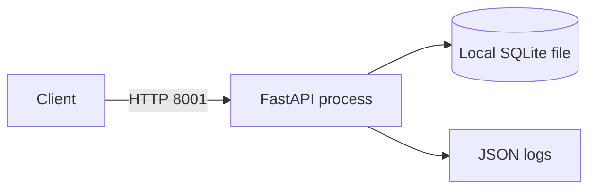
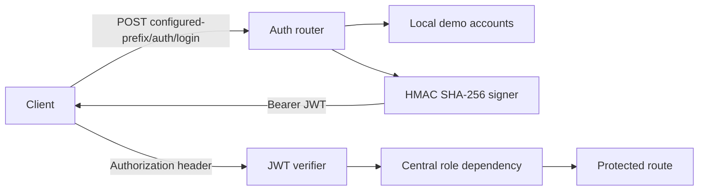
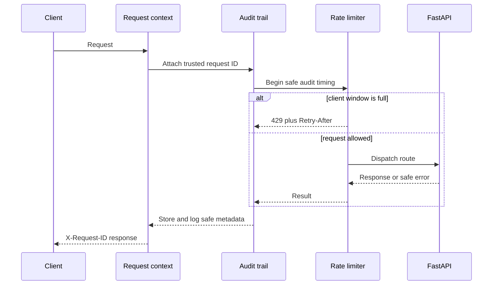
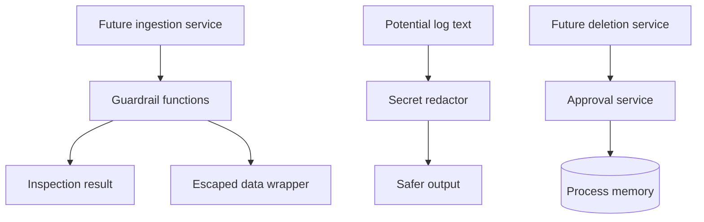
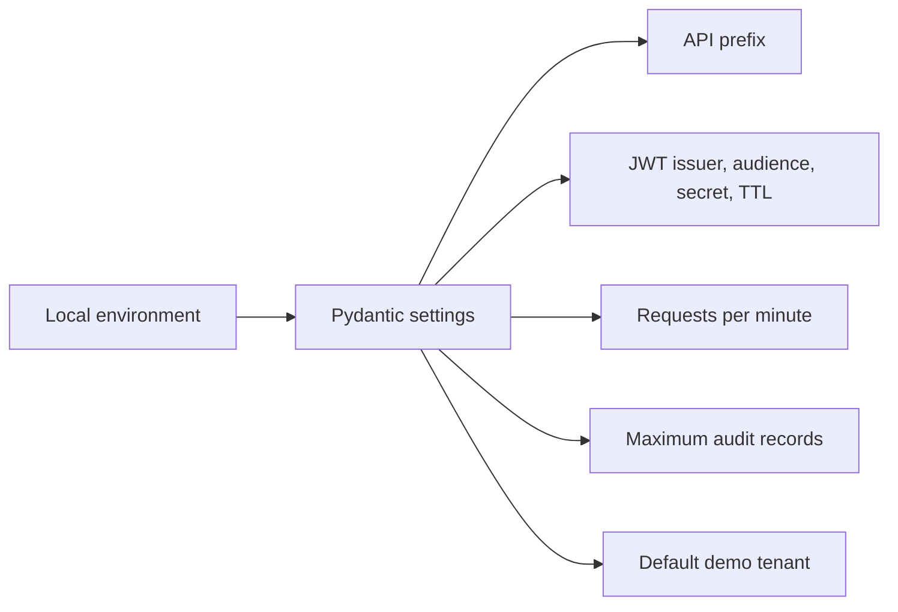
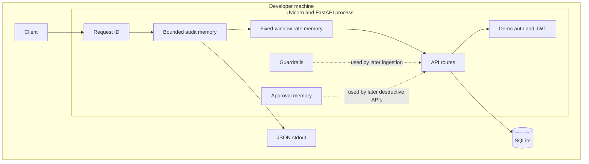
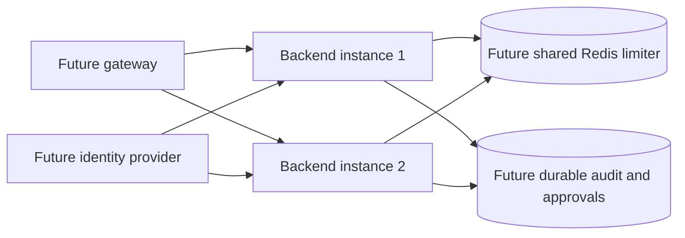

# Phase 3 Infrastructure Design Evolution

## Scope

Phase 3 changes component wiring inside the FastAPI process. It creates no
Docker image, Compose service, network, port, Redis server, or external identity
provider. The only listening process remains Uvicorn on the configured local
address, normally port 8001.

## Beginning topology

Phase 2 persistence was available, but inbound traffic had no identity or
traffic-control corridor.

## Authentication wiring

Demo login and token verification run in the same Python process.

No password database or authentication network call is used. Demo credentials
are deliberately disabled in staging and production. Production identity is a
future adapter, not a hidden Phase 3 service.

## Middleware routing

The limiter and audit trail are local memory components protected by locks.
They work across threads in one process but are not shared between multiple
workers or machines. The audit trail retains only the configured number of most
recent records.

## Content and action wiring

Guardrails and approvals are library components, not network services.

Phase 3 prepares these boundaries before later ingestion and deletion endpoints
exist. This avoids coupling their security behavior to a future UI or storage
provider.

## Configuration routing

Secrets stay in environment settings. `.env` is ignored; `.env.example` contains
only an explicitly local demo value and instructions to replace it.

## End-of-phase local topology

## Docker and production evolution

Phase 3 has no Docker networking. A later multi-instance design must replace
process-local coordination with shared services:

Redis, PostgreSQL persistence, external identity, proxy trust rules, key
rotation, and container wiring remain later delivery work. Phase 3 supplies
testable interfaces and honest local behavior without claiming those services
already run.

## Operational summary

One request enters one process, receives a safe correlation ID, is checked
against a local traffic window, is audited using limited non-secret metadata,
and then reaches authentication and the route. Untrusted information and
destructive actions have separate safety boundaries. This topology is enough
for deterministic offline development and a clear stepping stone to shared
production infrastructure.

The final verification exercised successful, unauthorized, forbidden,
rate-limited, and unexpected-error responses and confirmed that all of them
carry the expected safe error or request-correlation behavior.
