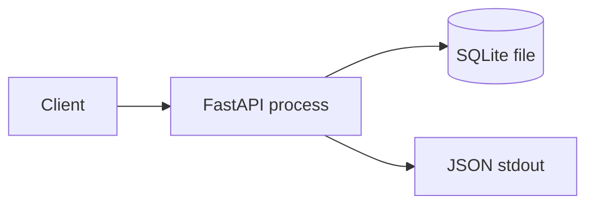
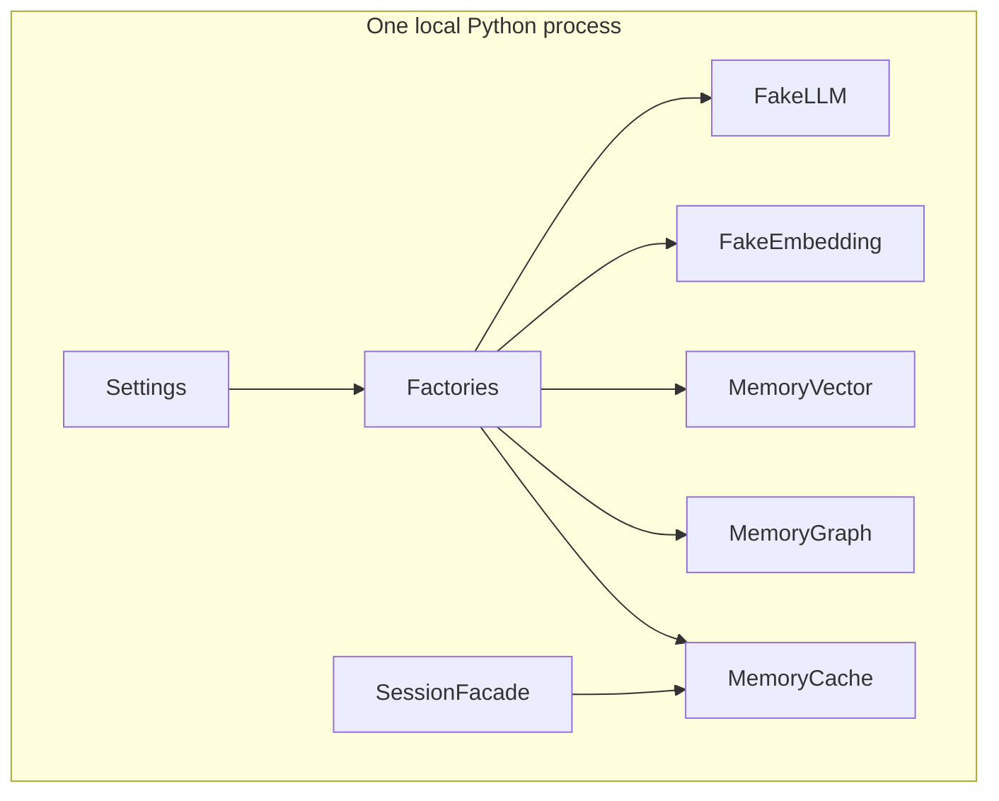
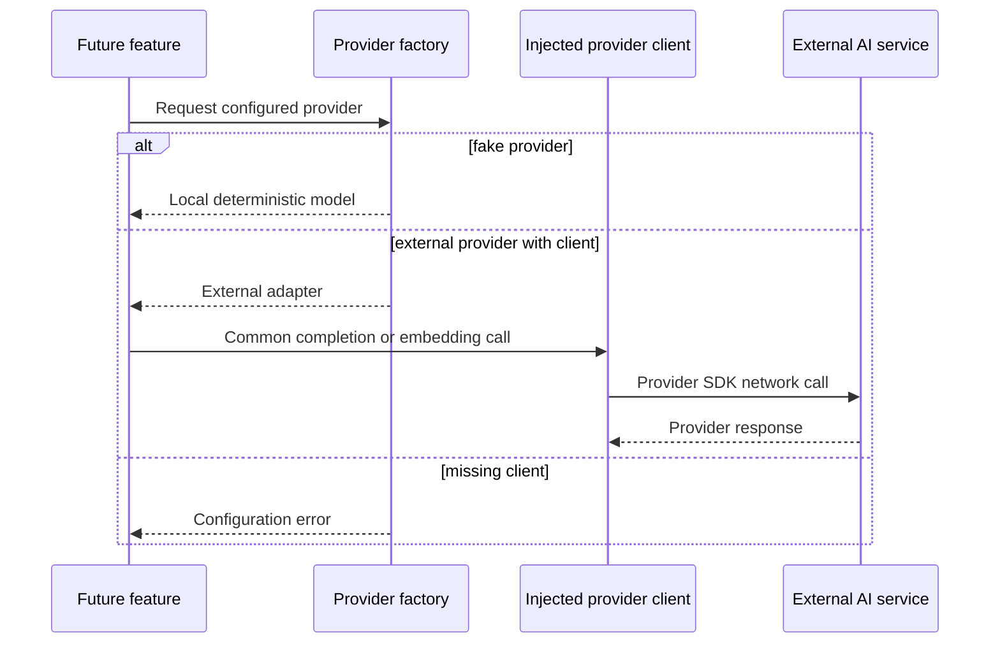
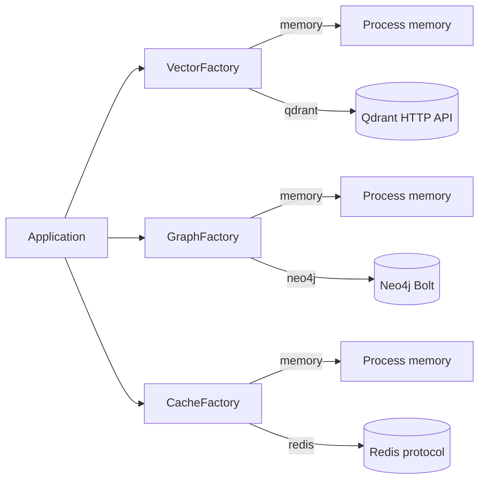
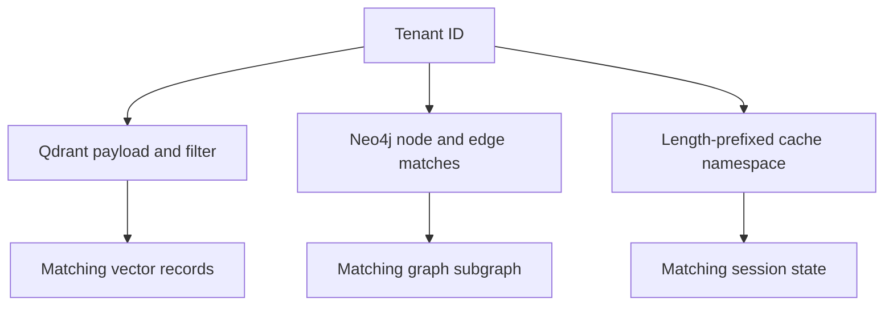
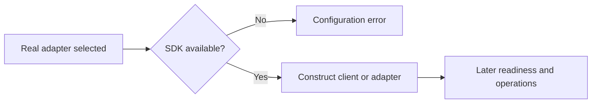
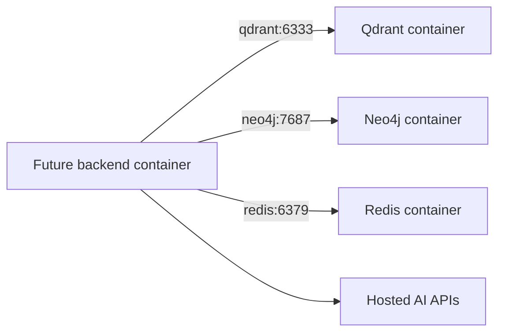

# Phase 4 Infrastructure Design Evolution

## Scope

Phase 4 introduces infrastructure choices without starting infrastructure. The
default topology is still one Python process plus the existing SQLite file.
Qdrant, Neo4j, Redis, and hosted AI services are optional connection targets.

## Starting topology

Specialized retrieval and cache services did not yet have a wiring boundary.

## Offline component wiring

These components communicate with ordinary Python calls. They open no ports,
create no background process, and make no network request.

## Optional AI-provider wiring

Phase 4 does not create or store API keys. The application composition layer
must supply a configured client for a hosted AI provider.

## Optional storage wiring

Configuration routes each factory:

| Capability | Offline value | Optional value | Default endpoint |
|---|---|---|---|
| LLM | `fake` | injected real provider | provider-controlled |
| Embeddings | `fake` | injected real provider | provider-controlled |
| Vector store | `memory` | `qdrant` | `http://localhost:6333` |
| Graph store | `memory` | `neo4j` | `bolt://localhost:7687` |
| Cache | `memory` | `redis` | `redis://localhost:6379/0` |

Qdrant may receive an API key. Neo4j username and password must be configured
together. Redis credentials can be part of its connection URL. Example values
remain commented or local-only in `.env.example`.

## Tenant routing

Tenant scope travels with each adapter instance rather than being an optional
argument on individual searches. This makes the safe path the easiest path.

## Failure routing

Real adapters are loaded lazily. Selecting an unavailable SDK fails during
factory construction with the missing package named in the error. A failure is
not silently replaced with memory storage because that could make production
appear healthy while writing to temporary state.

## Docker networking status

Phase 4 adds no Dockerfile, Compose file, container hostname, volume, published
port, or health check. The localhost URLs are configuration defaults, not proof
that services are running.

A later Compose topology can wire the same factories differently:

## Operational summary

Phase 4 makes local operation self-contained while defining honest connection
points for real infrastructure. The same calling code can move from memory to
Qdrant, Neo4j, or Redis through settings and adapter construction. Network
services remain optional, failures are explicit, and tenant context is carried
through every specialized storage path.

Verification used only memory adapters and injected client doubles; no external
port, credential, container, or live network service was required.
