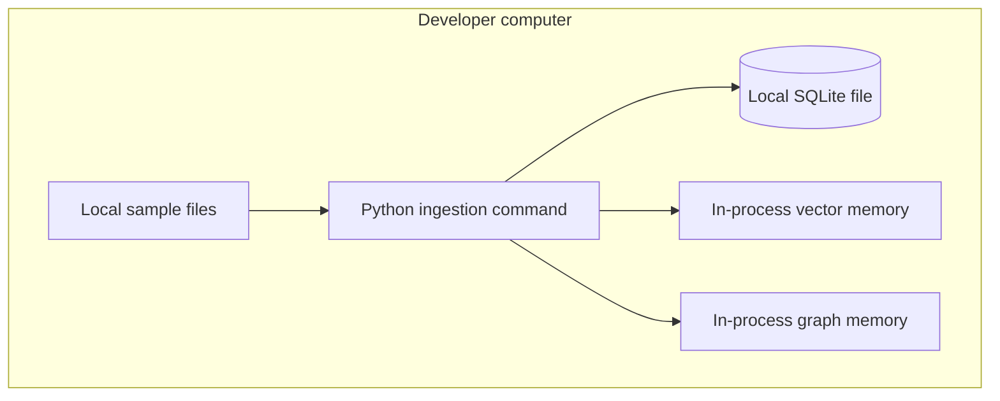
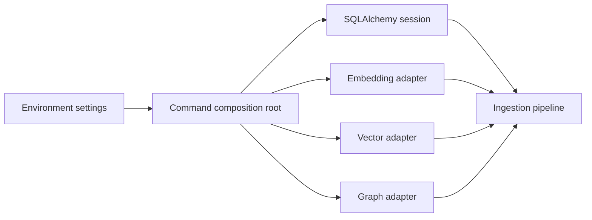
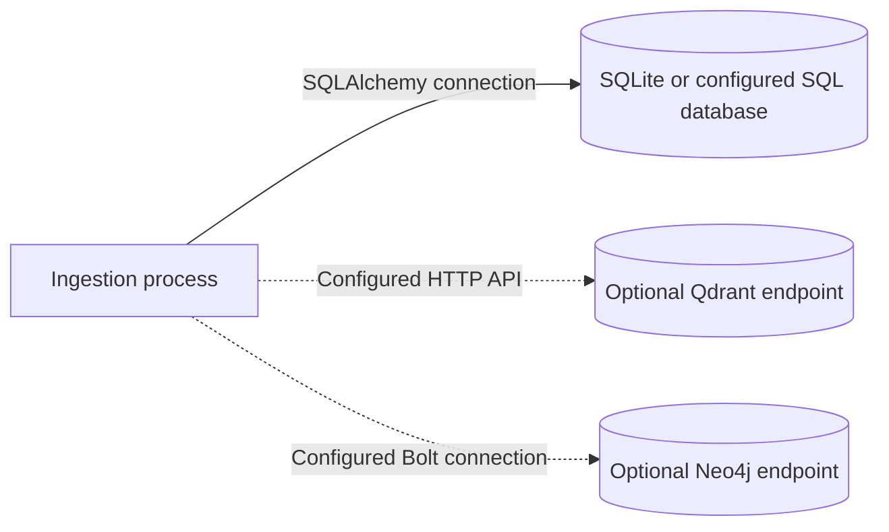
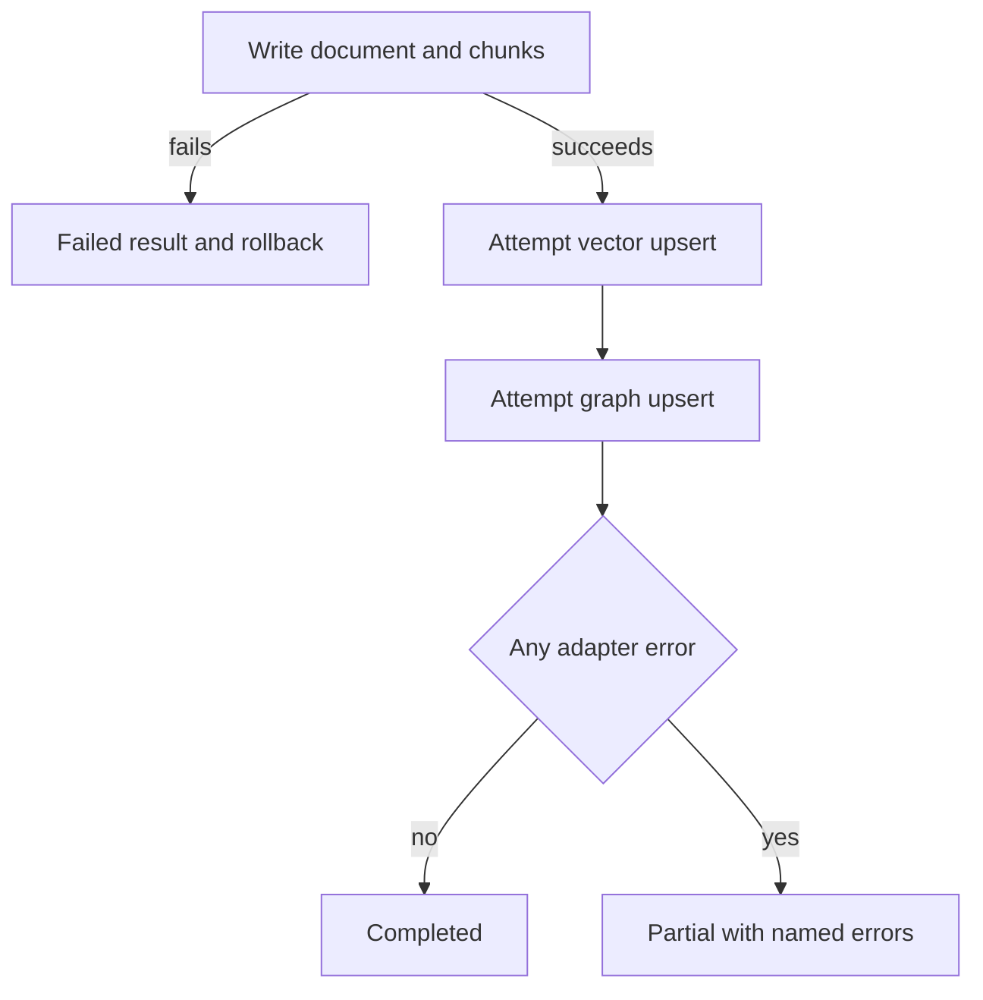

# Phase 5 — Infrastructure Design Evolution

## What is actually running in Phase 5

The default Phase 5 path is one Python process. SQLite is a local file; the
vector and graph adapters are in-memory Python objects. There is no container
network and no remote routing in the default setup.

In-memory vector and graph data lasts only for the command process. Relational
documents and chunks persist in SQLite. This is intentional for deterministic
development and testing.

## Component wiring

The command constructs settings, a database session, the embedding provider,
and tenant-specific store adapters. It injects them into the pipeline instead
of letting ingestion create hidden network clients.

## Optional external routing

Phase 4 adapters allow later environments to route vector operations to Qdrant
and graph operations to Neo4j. Those services are optional; Phase 5 neither
deploys them nor claims they are available. No Docker or Compose topology is
introduced in this phase.

Dashed routes exist only when the operator explicitly selects and configures
the corresponding adapter. The offline test suite never opens those routes.

## Failure routing

Relational storage is the durable source record. Vector and graph work is
attempted independently afterward so one optional adapter cannot be mistaken
for total success.

## Operational boundaries

- File type and size are checked before parsing.
- Only a filename is stored as source metadata; local parent paths are not
  exposed.
- PDF parsing is local through `pypdf`.
- No credentials are needed for default SQLite/memory operation.
- External credentials, networking, deployment, health checks, and retries
  belong to later infrastructure phases.
