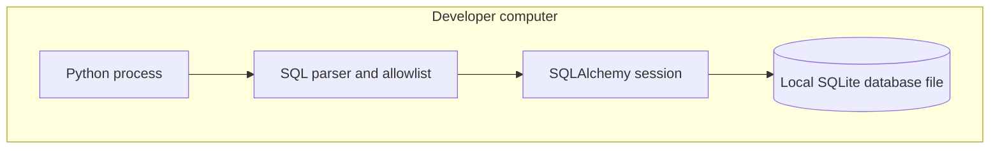
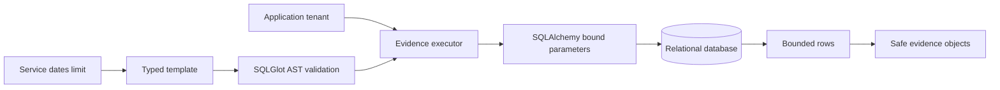
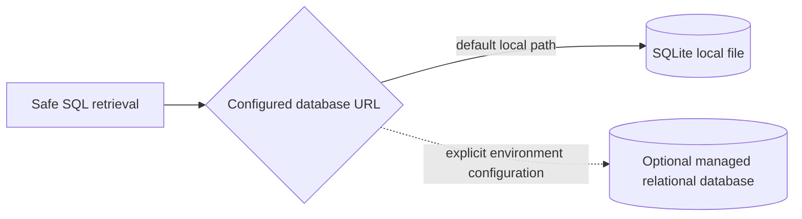
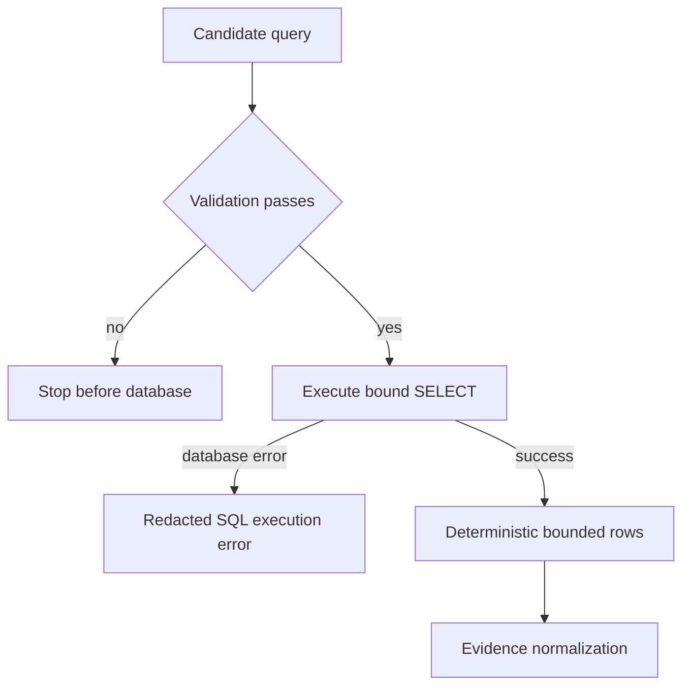

# Phase 6 — Infrastructure Design Evolution

## What actually runs in Phase 6

The default Phase 6 path stays inside one Python process and one local SQLite
file. No container, database proxy, or new network route is introduced.

## Component wiring and trust boundaries

The query builder owns the fixed SQL shape. The caller supplies ordinary
values. The validator inspects structure, and the executor overwrites the
tenant parameter with the authenticated application tenant before SQLAlchemy
binds values to the database call.

The database receives one `SELECT`. User text is never concatenated into that
statement. Database failures pass back through secret redaction before they can
reach a workflow or log-facing error.

## Local and configured database routing

SQLite is the deterministic default. A configured PostgreSQL-compatible URL can
use the same SQLAlchemy boundary in a later environment. Phase 6 adds neither a
Docker network nor a production deployment claim.

The dashed route exists only when an operator configures it. Credentials remain
in environment configuration and never become query parameters, evidence, or
error details.

## Rejection and failure routing

## Operational boundaries

- Allowed tables and columns are explicit in code.
- Schema-qualified tables, comments, semicolons, subqueries, set operations,
  wildcard columns, string literals, unapproved functions, `SELECT INTO`, and
  locking selects are rejected.
- Every referenced table needs a tenant predicate.
- Every query needs a maximum result limit.
- Phase 6 performs no insert, update, delete, schema, attachment, transaction,
  or filesystem SQL operation.
- Connection pooling, replicas, proxies, container networking, database roles,
  and production read-only credentials belong to later delivery phases.
