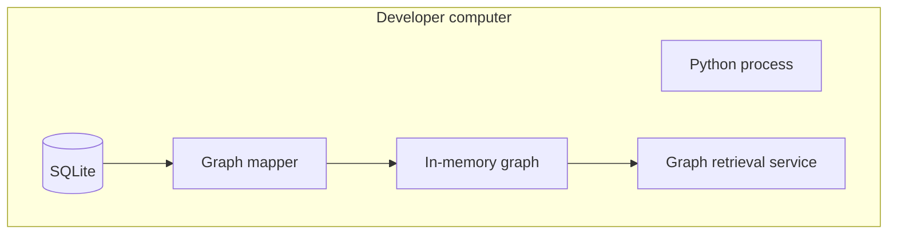
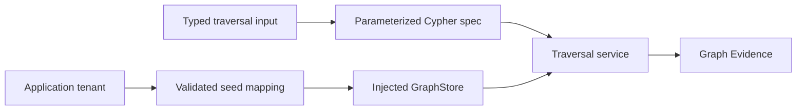
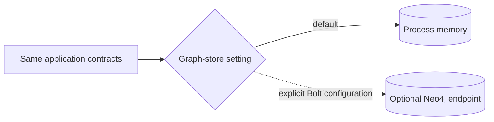
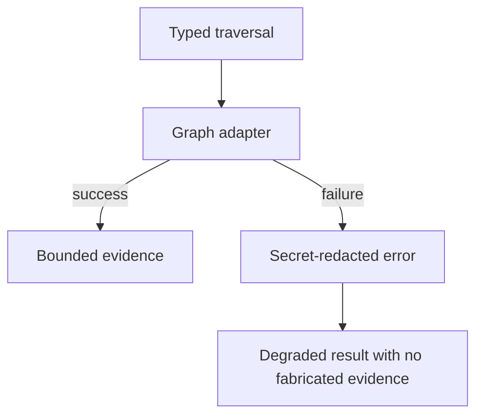

# Phase 7 — Infrastructure Design Evolution

## Default local wiring

Phase 7 introduces no new container or network requirement. Tests and local
development use an in-process graph store populated from isolated SQLite data.

## Component routing

Tenant identity is present on every node and edge. The retrieval service also
rejects any cross-tenant node returned by an adapter.

## Optional Neo4j routing

The dashed route exists only when configured. Phase 7 does not deploy Neo4j,
Docker networking, credentials, retries, or production health infrastructure.

## Failure routing

This boundary allows a later multi-source workflow to continue with SQL or
document evidence even when graph retrieval is temporarily unavailable.
