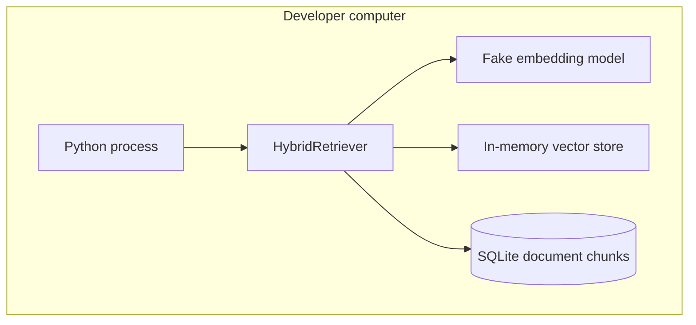
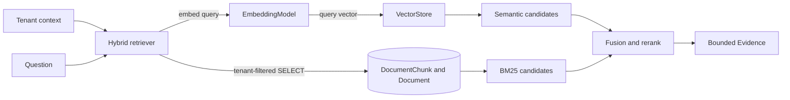
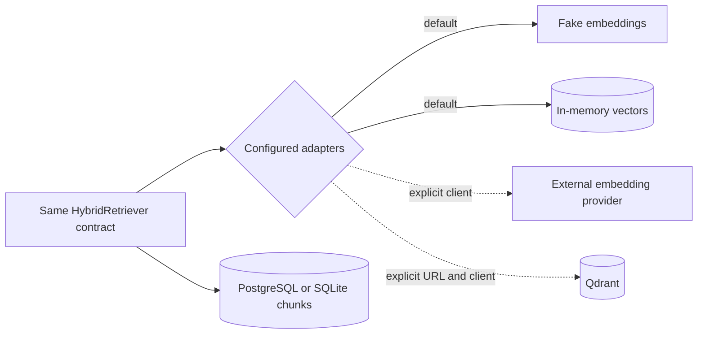
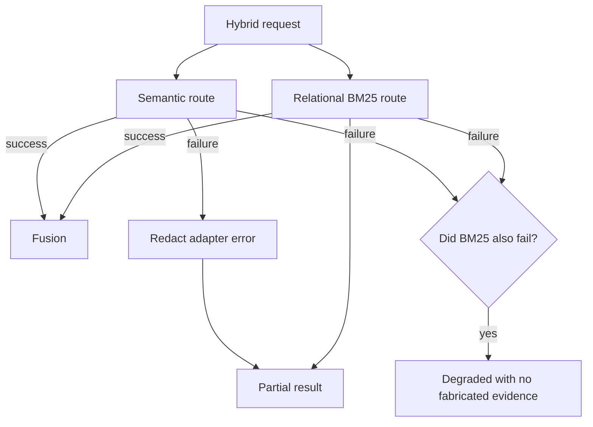
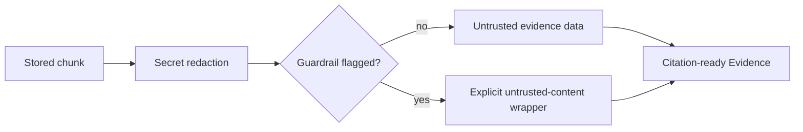

# Phase 8 — Infrastructure Design Evolution

## Default local wiring

Phase 8 adds no required container. The complete offline path runs inside one
Python process with SQLite, deterministic fake embeddings, and the in-memory
vector store.

There is no network traffic in this configuration, and the test harness blocks
external connections.

## Component wiring and request routing

The injected vector store is created for one tenant, and the relational query
also contains an explicit tenant filter. Source filename, page, and chunk
metadata travel with the candidate into its final evidence locator.

## Optional production adapter route

The dashed routes are optional adapter choices already established in Phase 4.
Phase 8 does not deploy Qdrant, an embedding service, Docker networking, retry
workers, or production credentials.

## Degraded routing

One working retrieval route can still provide evidence with a `partial` status.
If neither route works, the result is `degraded`. Error text is secret-redacted
before it crosses the retrieval boundary.

## Security boundary

Retrieved text never becomes code, SQL, routing configuration, or an agent
instruction. The safety metadata stays attached for later workflow decisions.
