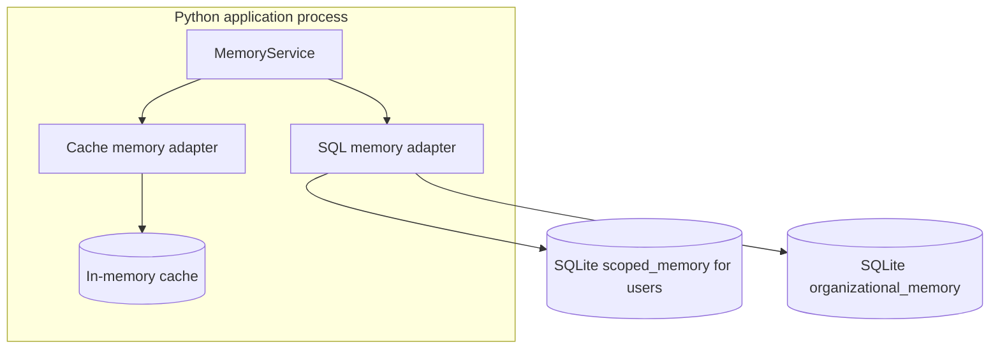
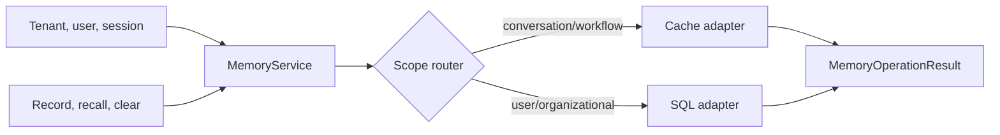
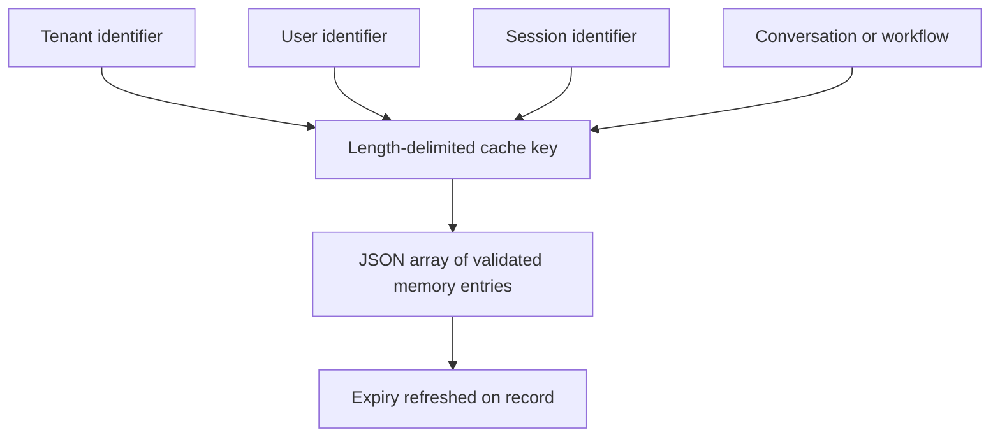
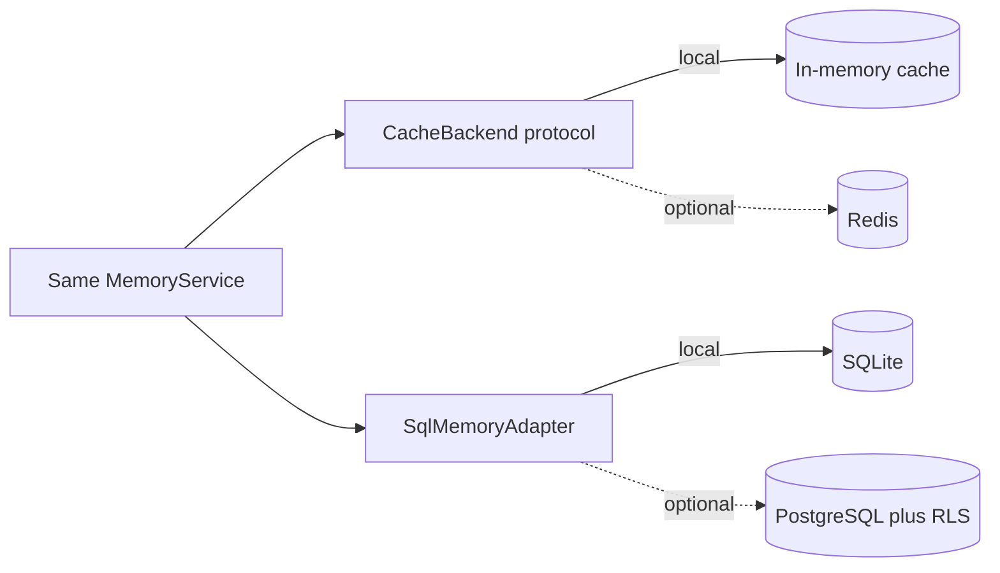
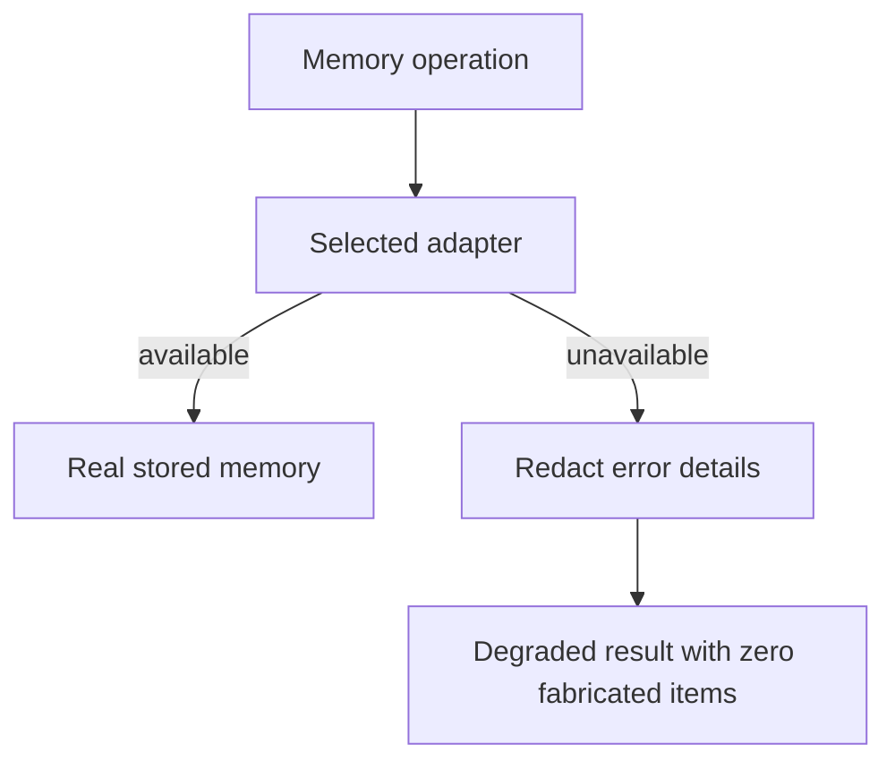

# Phase 9 — Infrastructure Design Evolution

## Default local wiring

Phase 9 requires no Docker services for development or tests. SQLite stores
durable scopes and the process-local cache stores temporary scopes.

All tests run through this route without network access, credentials, or
containers.

## Request wiring and routing

Tenant ownership is applied in both routes. Cache keys additionally encode the
user, session, and scope; SQL statements include tenant, scope, and user
predicates.

## Cache key isolation

Length-delimited values prevent ambiguous key combinations. Expiry keeps
temporary memory from becoming accidental permanent storage.

## Optional production wiring

The Phase 4 cache protocol already supports Redis. The new durable user-memory
table is included in the Alembic migration chain and PostgreSQL
row-level-security policy list. Organizational memory continues to use the
Phase 2 table and seeded facts. Phase 9 does not deploy those external services.

## Failure boundary

An unavailable cache or database never causes the service to silently borrow
data from a different scope or manufacture remembered facts.

