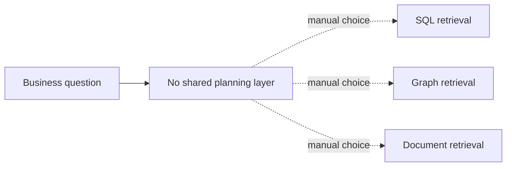
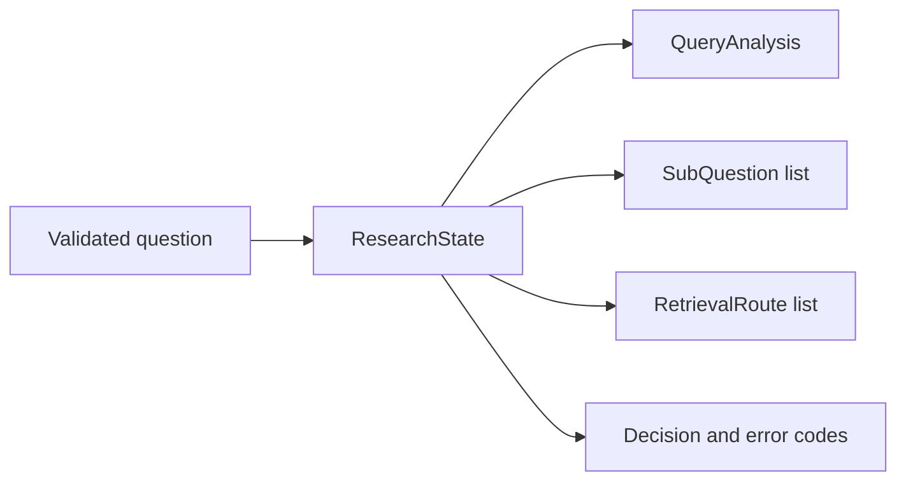
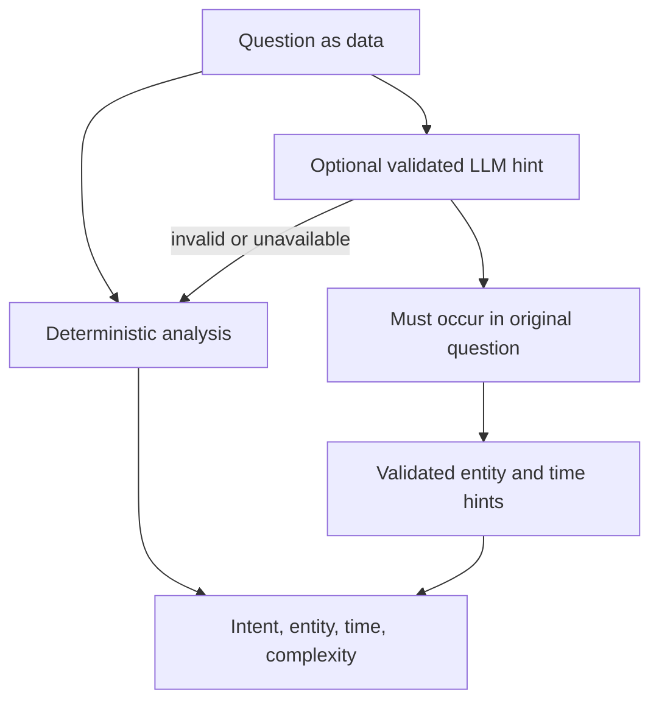
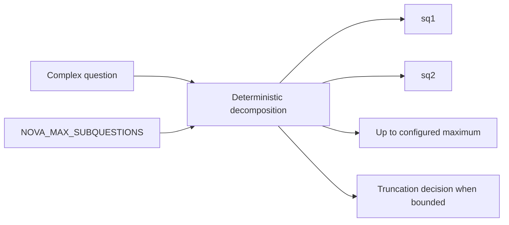
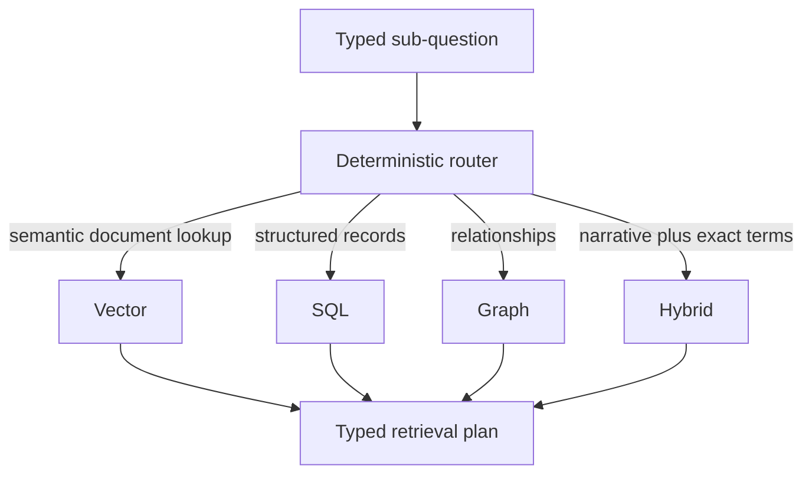
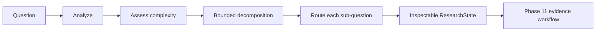

# Phase 10 — Project System Design Evolution

## Starting point

Earlier phases supplied retrieval engines, but callers still had to choose one.

## P10-1 — Typed state and node contracts

One immutable state shape prevents nodes from passing informal dictionaries.
The declared node sequence makes progress inspectable without exposing hidden
reasoning.

## P10-2 — Analysis and complexity

Deterministic rules stay authoritative. Relative time expressions remain
unresolved rather than silently using the machine clock.

## P10-3 — Bounded decomposition

The default maximum is four and validation permits only one through eight.
Duplicate sub-questions are removed while order stays stable.

## P10-4 — Retrieval routing

Routing creates plans only. Existing retrievers remain separate and execute in
the later evidence workflow.

## End-of-phase design

Phase 10 ends with a deterministic and provider-neutral planning boundary that
can be persisted and displayed before any retrieval tool is called.
