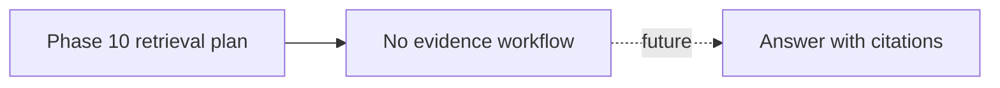
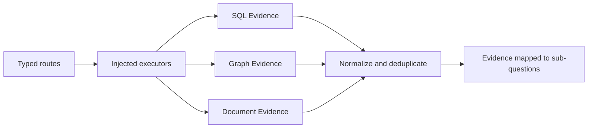
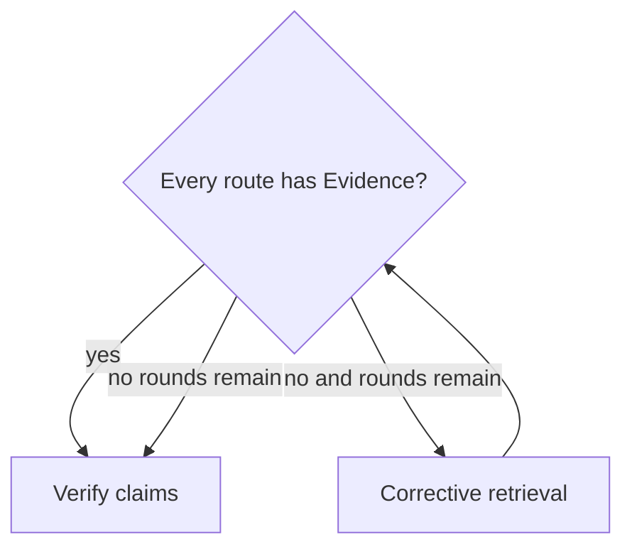
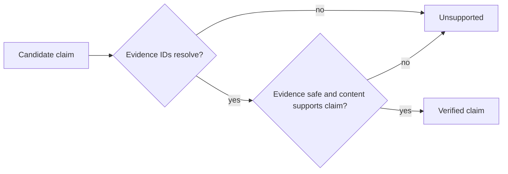
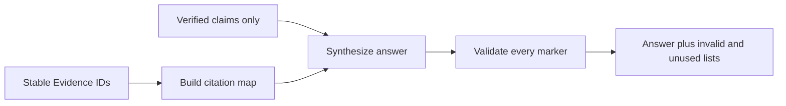
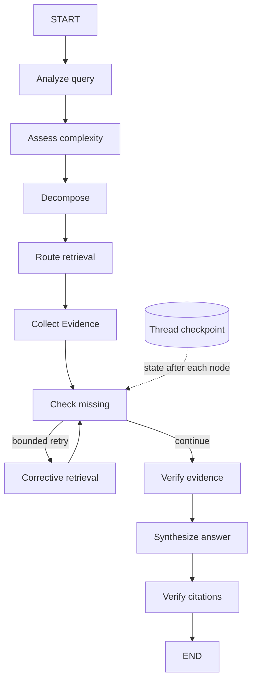

# Phase 11 — Project System Design Evolution

## Starting point

Phase 10 could plan retrieval but did not execute or combine results.

## P11-1 — Evidence collection

Failures stay attached to the affected sub-question, while successful paths
continue. Deduplication uses stable source identity and preserves coverage
provenance through the sub-question mapping.

## P11-2 — Missing evidence and bounded correction

`NOVA_MAX_CORRECTIVE_ROUNDS` defaults to one and is bounded from zero through
three. The conditional graph edge therefore cannot become an unbounded loop.

## P11-3 — Claim verification

The deterministic verifier is intentionally conservative. It excludes hostile
content and rejects claims containing substantive terms absent from the linked
evidence.

## P11-4 — Answer and citations

If no verified claim exists, synthesis returns an explicit insufficient-
evidence message with no citation instead of guessing.

## P11-5 — End-of-phase LangGraph

The completed graph is explicit, checkpointed, deterministic with local
executors, and inspectable without exposing hidden reasoning.
