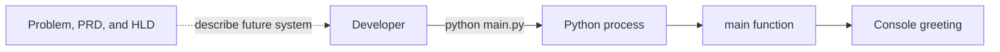
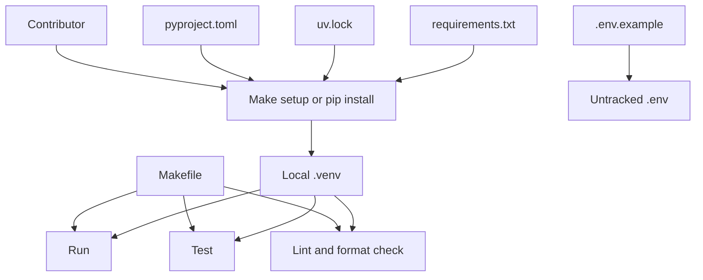
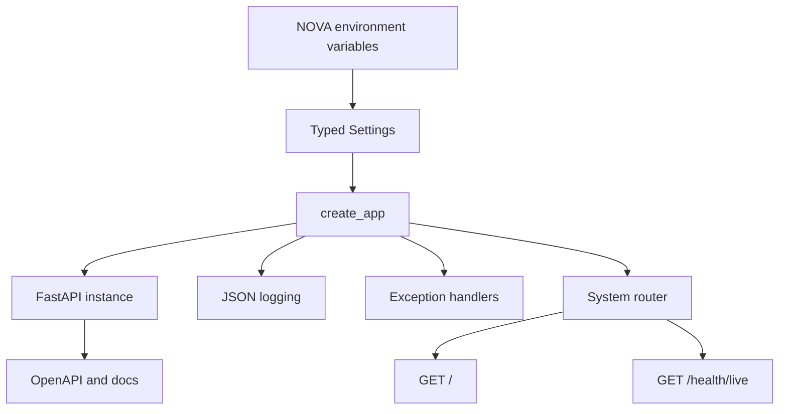
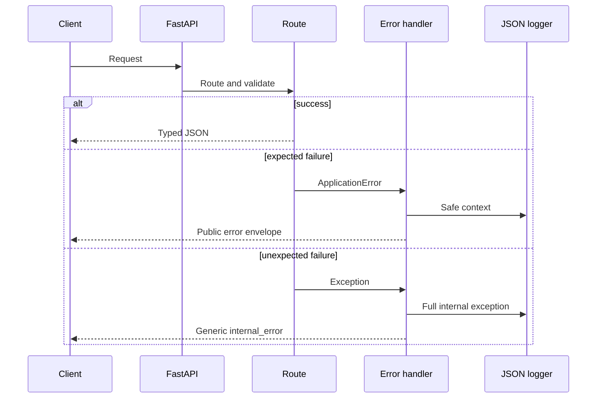
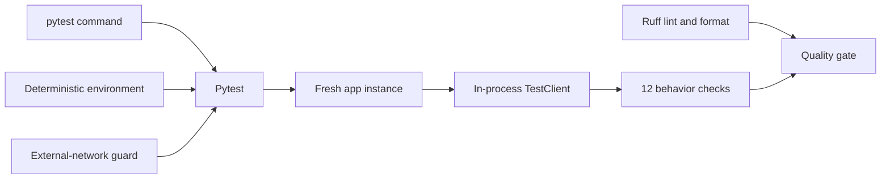
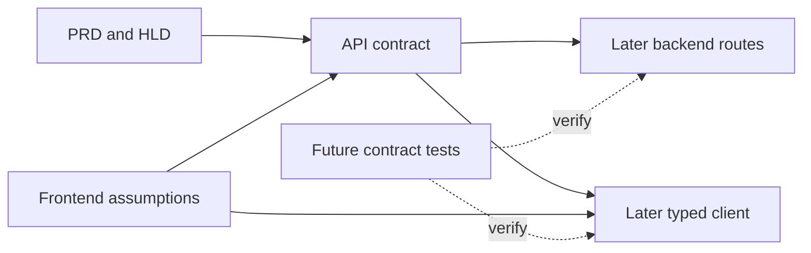
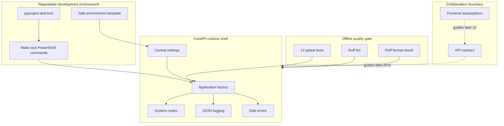

# Phase 1 Project System Design Evolution

## Purpose

This document shows how NovaEnterprise evolved during Phase 1, from a single
console script to a verified FastAPI foundation. It describes implemented code;
later business capabilities remain future work.

## Beginning of Phase 1 — the original scaffold

The repository started with project metadata, design documents, and a `main.py`
that printed one greeting.

This baseline proved that Python ran, but it had no web boundary, central
configuration, structured logging, error policy, automated test harness, or API
contract.

## P1-1 — repeatable workspace

P1-1 established a reproducible way to build and operate the project.

Key decisions:

- `pyproject.toml` is the authoritative dependency and tool configuration.
- `uv.lock` makes resolution reproducible.
- `.env.example` contains names and safe defaults, never real secrets.
- Make targets and documented PowerShell alternatives provide the same workflow.
- The mistyped package scaffold was corrected to `src/novaenterprise/__init__.py`.

P1-1 was implemented first because every other Phase 1 task depends on the same
environment and commands.

## P1-2 — backend runtime shell

P1-2 introduced a thin FastAPI application without pulling later business logic
into the foundation.

The application factory is the central composition root. Configuration, logging,
errors, and route registration meet there, while each concern remains in its own
module.

### Request behavior

The public response is safe and stable; sensitive diagnostic detail stays in the
server log.

## P1-3 — deterministic verification

P1-3 made the foundation testable without cloud dependencies.

The tests cover:

- central settings and validation;
- service metadata and liveness;
- the exact Phase 1 OpenAPI route set;
- public application, validation, and unexpected-error behavior; and
- JSON log structure and idempotent logging setup.

The test fixture blocks external network access. The suite needs no API key,
database, Docker service, or running web server.

## P1-4 — contract-first collaboration

P1-4 created a written boundary for later frontend and backend development.

The API contract separates implemented Phase 1 endpoints from planned research
and browse endpoints. The frontend assumptions define polling, roles, citations,
errors, accessibility, and degraded behavior without pretending a frontend
already exists.

## End-of-Phase-1 architecture

## Dependency improvements achieved

| Design choice | Dependency problem avoided |
|---|---|
| Workspace before runtime/tests | Competing dependency and command definitions |
| Application factory | Tests or environments manually assembling different apps |
| Central typed settings | Modules reading and interpreting environment variables differently |
| Standard-library JSON logger | Feature modules inventing incompatible log formats |
| Shared error envelope | Each route exposing different or unsafe failures |
| Offline test fixture | Tests requiring paid APIs or unavailable infrastructure |
| Contract-first boundary | Frontend and backend guessing incompatible payloads |

## Deliberate boundaries

Phase 1 contains no database, authentication, retrieval, memory, agent workflow,
frontend, Docker image, or deployment. Those remain isolated in later phases so
the runtime foundation stays small, reviewable, and reusable.

## Completion evidence

Phase 1 completion is supported by:

- all P1-1 through P1-4 artifacts present;
- 12 passing offline tests;
- Ruff lint and format checks passing;
- Python compilation passing;
- `uv.lock` matching `pyproject.toml`; and
- current routes and planned interfaces clearly separated in documentation.
