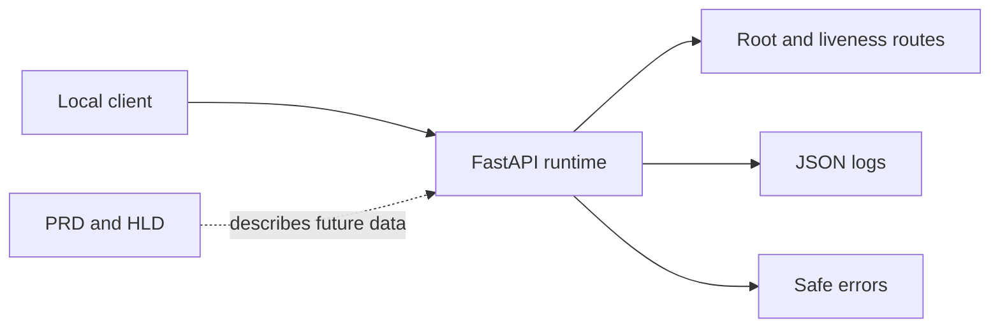
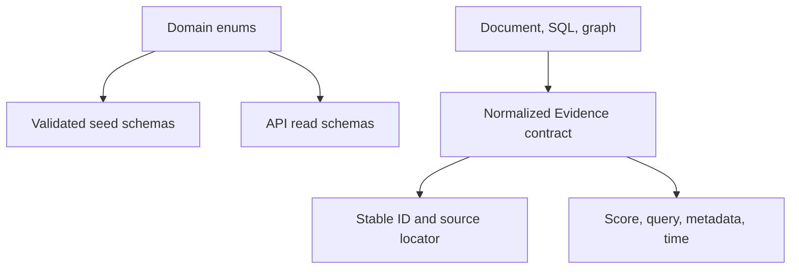
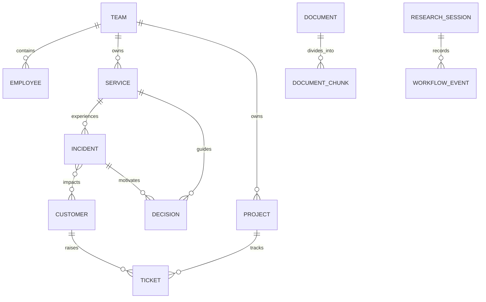
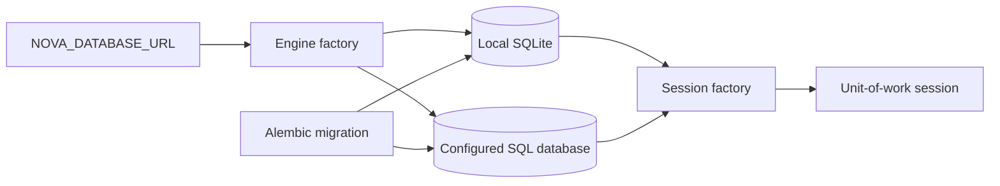
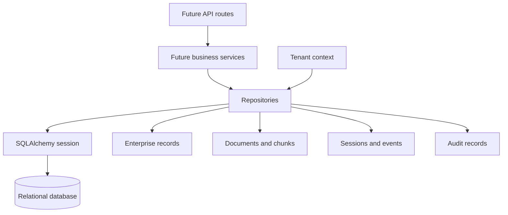
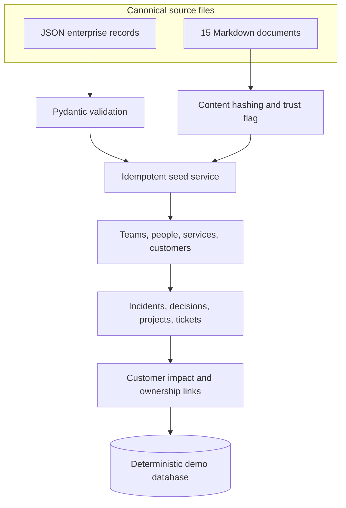
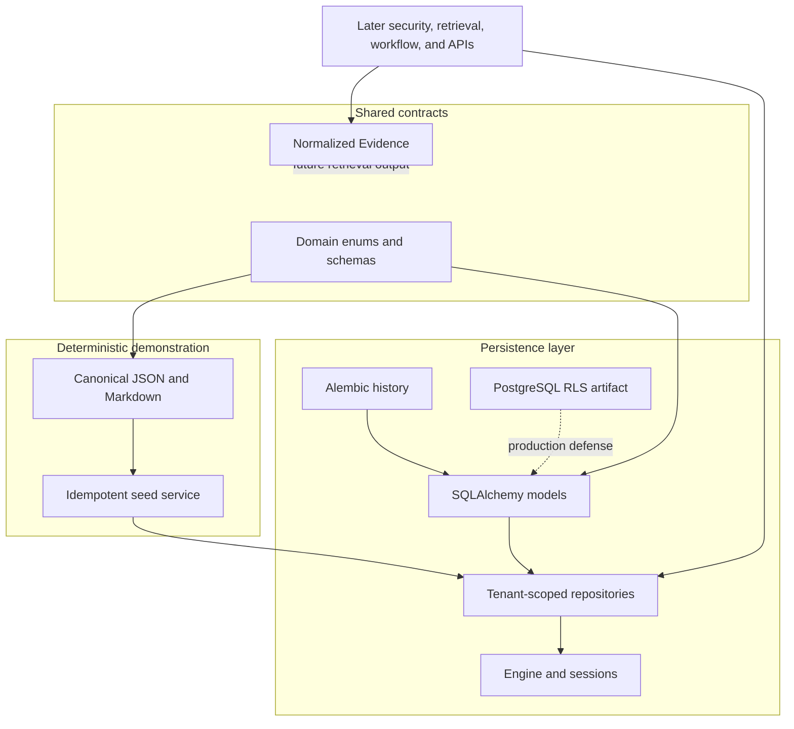

# Phase 2 Project System Design Evolution

## Purpose

This document shows how NovaEnterprise evolved during Phase 2 from a stateless
runtime shell into a schema-driven persistence foundation. It describes Phase 2
code only. Authentication, retrieval, agent workflows, browse APIs, and the
frontend remain later work.

## Beginning of Phase 2 - a reliable but stateless service

At the end of Phase 1, the FastAPI application could start, validate settings,
log safely, return consistent errors, and pass offline tests. Business entities
still existed only in design documents.



There was no shared domain vocabulary, relational schema, repository boundary,
migration history, or canonical database state.

## P2-1 - shared domain and evidence contracts

The first step was to make types and meanings independent of storage.



Design decisions:

- `StrEnum` values give APIs, JSON files, and models the same vocabulary.
- Pydantic models reject extra fields and can validate ORM objects.
- seed schemas validate the canonical dataset before it reaches the database.
- read schemas add tenant context to outward-facing records.
- `Evidence` is frozen and store-neutral, so downstream verification and
  citation logic need one interface rather than three.

P2-1 had to come first because models, repositories, and sample data all import
these contracts.

## P2-2 - tenant-aware relational persistence

P2-2 mapped business concepts to SQLAlchemy 2 models and introduced one database
composition boundary.



The model set also includes organizational memory and audit records. Every
business table carries `tenant_id`; most mutable records also carry creation and
update timestamps.

### Engine and session boundary



SQLite connections enable foreign-key checks. The default remains lightweight
for local work, while the configured URL keeps the design portable.

The initial Alembic revision creates the full Phase 2 metadata. The separate
PostgreSQL policy artifact enables tenant row-level security and compares each
row with the session's `app.tenant_id`. That database control is not available
in SQLite and is never presented as if it were.

## P2-3 - repository boundary

P2-3 stopped higher layers from depending directly on SQLAlchemy statements.



The generic repository provides tenant-scoped add, get, list, and count
operations. Specialized repositories express useful queries in business terms.
This keeps SQL out of API and service code and provides a single place to test
tenant filtering, pagination, ordering, and relationship loading.

The repository boundary is application-level isolation. PostgreSQL RLS is an
additional defense for the production-style database path, not a substitute for
correct application queries.

## P2-4 - deterministic enterprise state

The final Phase 2 step connected validated source fixtures to the relational
model.



The seeder loads parent records before dependent records, uses stable IDs, and
merges rather than blindly appending. It establishes the exact project counts:
6 teams, 20 employees, 8 services, 10 customers, 12 incidents, 8 decisions,
6 projects, 15 tickets, 3 organizational-memory facts, and 15 documents.

The Payments API incidents and relationships support the canonical business
question. The hostile vendor note is stored and marked untrusted so later
ingestion and security tests have a realistic adversarial fixture.

## End-of-Phase-2 architecture



The application remains layered:

```text
HTTP routes -> services -> repositories -> SQLAlchemy session -> database
                     schemas are shared contracts across these boundaries
```

Phase 2 builds the bottom two business layers and the contracts. It does not
skip ahead by exposing new HTTP behavior.

## Dependency improvements achieved

| Design choice | Dependency problem avoided |
|---|---|
| Schemas before models | Storage code inventing a different vocabulary |
| One Evidence contract | SQL, graph, and document results becoming incompatible |
| Models before repositories | Repositories depending on unfinished table shapes |
| Tenant mixin plus tenant repositories | Isolation added inconsistently per query |
| Alembic initial revision | Environments creating undocumented schemas |
| Repositories before seeding | Seed logic spreading ad hoc SQL through scripts |
| Fixed IDs and merge seeding | Duplicate demo records after every run |
| Canonical fixtures | Tests and demonstrations disagreeing about business facts |

## Deliberate boundaries

Phase 2 does not implement Phase 3 identity or authorization, Phase 5 document
chunking/indexing, Phase 6 SQL retrieval, Phase 7 graph storage, Phase 8 hybrid
retrieval, Phase 11 answer workflow, or Phase 12 browse APIs. Tables and
contracts may support those later features, but support is not implementation.

## Completion evidence verified in the branch

The Phase 2 implementation was verified by focused tests for:

- strict domain and Evidence validation;
- upgrade and downgrade of the initial migration;
- tenant isolation and specialized repository queries;
- the explicit PostgreSQL RLS policy artifact;
- exact sample counts and relationships;
- canonical Payments API facts; and
- identical counts after repeated seeding.

The final offline suite passed 25 tests. A separate operational smoke test ran
the real Alembic upgrade, seeded the same database twice with unchanged counts,
and downgraded it successfully. Ruff lint and formatting checks also passed.

The task tracker rows remain `Pending` until the Phase 2 pull request is merged,
even when those checks pass on the feature branch.
