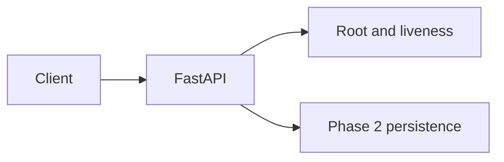
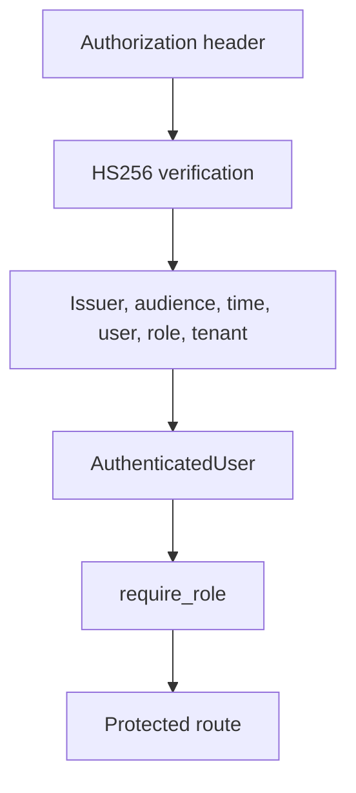
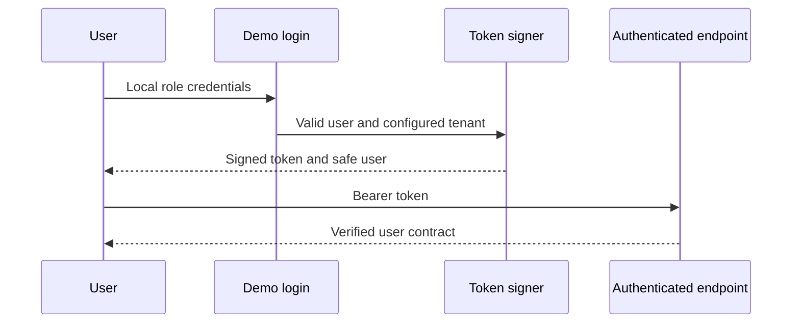
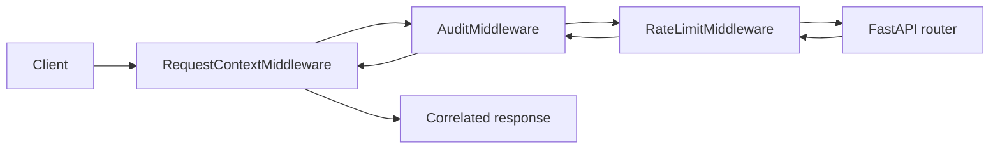
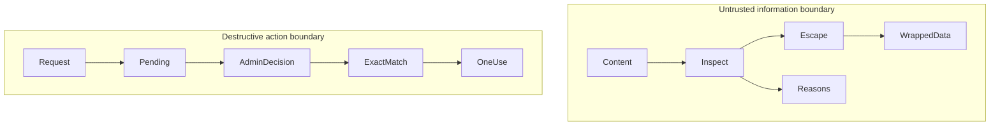
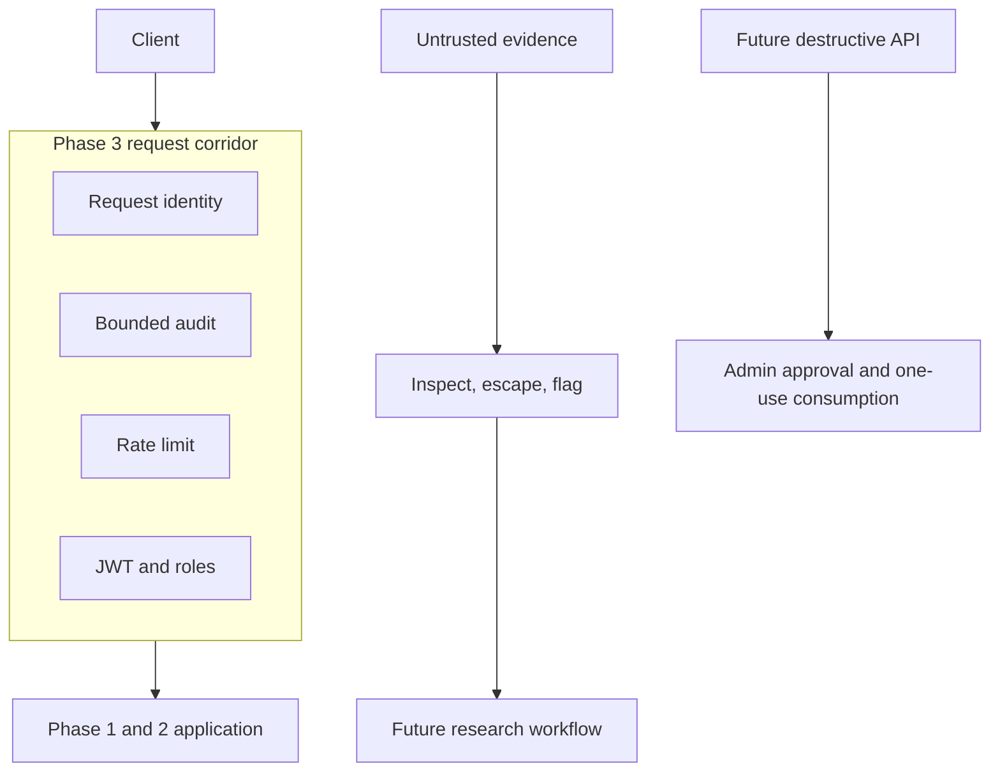

# Phase 3 Project System Design Evolution

## Starting point

Phase 2 ended with shared schemas, repositories, migrations, and canonical
data. The HTTP shell was still public and had no caller identity or uniform
request controls.

## P3-1: central identity boundary

The first evolution introduced an authenticated-user contract, signed access
tokens, and hierarchical role enforcement.

The important design choice is dependency injection: routes declare the
minimum role, while one security module validates every token and permission.
This prevents security behavior from drifting between endpoints.

## P3-2: local identity provider

The second step added an offline login adapter and a self-inspection endpoint.

Demo identity is enabled only for local and test environments. Production must
provide a non-demo secret of at least 32 characters. The token format remains a
standard JWT contract that a later identity provider can replace.

## P3-3: cross-cutting request controls

Request controls became middleware because correlation, limiting, and auditing
must apply consistently rather than depend on each route remembering them.

Starlette runs the last-added middleware first, so application construction
adds the layers in reverse execution order. Request context is outermost, audit
observes both accepted and rate-limited outcomes, and the limiter protects the
route. The centralized 500 handler also copies the stored request ID because
unexpected errors are finalized outside normal user middleware.

Phase 3 implementations are bounded local adapters:

- the fixed-window limiter is thread-safe and keyed by client address;
- the audit trail is thread-safe and retains only a configured maximum; and
- structured audit logs omit bodies, query parameters, credentials, and tokens.

## P3-4: content trust and human control

The final step protects two different boundaries: information entering an AI
workflow and destructive actions leaving it.

Guardrails scan suspicious phrases, HTML-escape content, and add an explicit
data-only instruction. Secret redaction handles bearer credentials, passwords,
API keys, AWS-style access keys, and private-key blocks before text is logged.

Approvals are tenant-scoped state machines. The action and resource must match
at consumption time, and consumption is atomic under a lock. The Phase 3 store
is in memory because no destructive public API exists yet; later persistence
can implement the same service contract.

## End-of-phase design

The dependency direction remains one-way: API routes use core security;
middleware surrounds the API; guardrails are lower-level utilities; and the
approval service contains no HTTP logic.

## Verification evidence

Phase 3 is covered by deterministic offline tests for token round trips,
signature and expiry failure, production-secret rejection, login, central RBAC,
custom prefixes and tenants, request IDs on successes and failures, rate-limit
responses, middleware audit ordering, bounded auditing, injection detection,
wrapper escaping, secret redaction, cross-tenant approvals, exact resource
matching, and replay prevention.

The final offline repository suite passed 48 tests, with Ruff lint and format
checks clean. The Phase 3 security modules were also exercised through the real
FastAPI middleware and exception stack rather than only as isolated functions.

The Phase 3 tracker rows remain Pending until the feature pull request merges.
