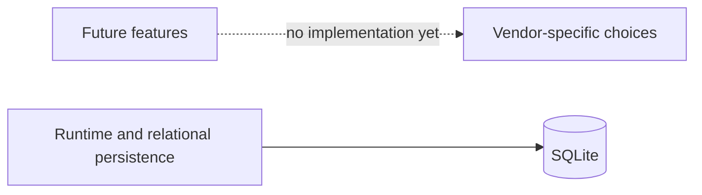
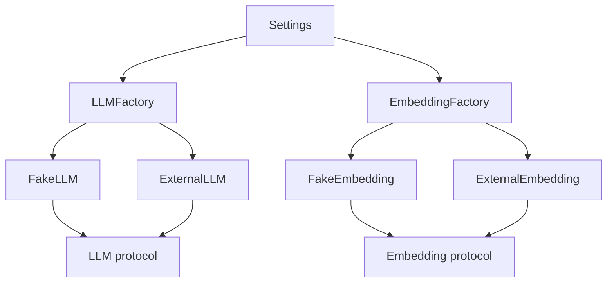
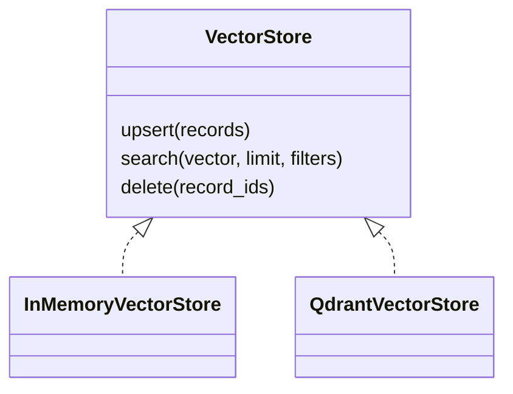
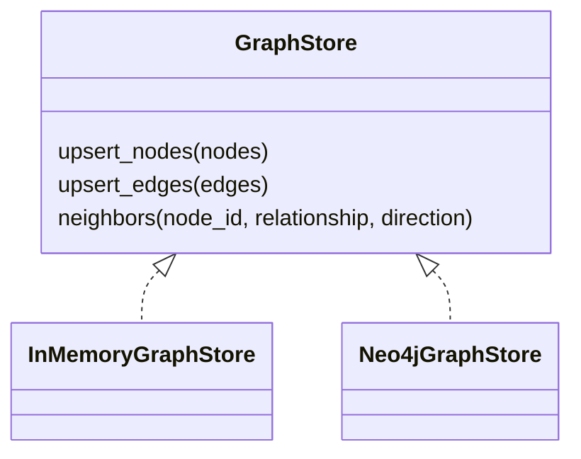
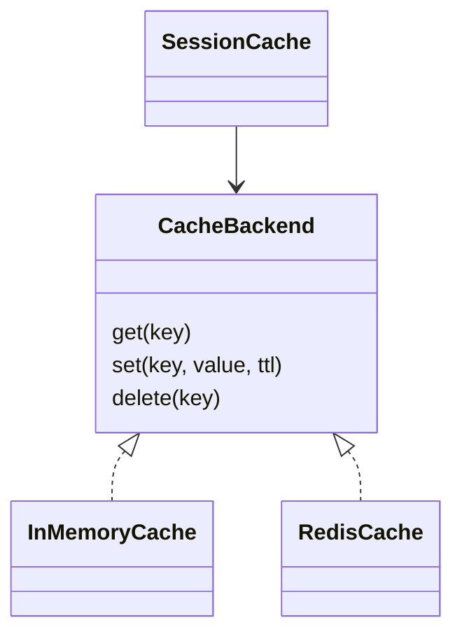
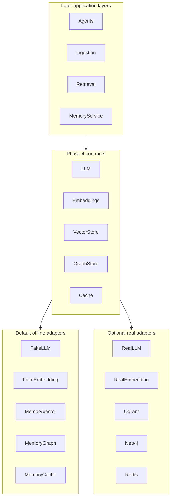

# Phase 4 Project System Design Evolution

## Beginning of Phase 4

Phases 1 and 2 provided the runtime, schemas, relational models, repositories,
and sample data. Later ingestion, retrieval, agents, and memory still had no
stable boundary for AI providers or specialized stores.

Phase 4 evolves this into dependency inversion: feature code depends on
protocols, while factories and adapters depend on configuration and SDKs.

## P4-1 and P4-2: computation providers

Both protocols return provider-neutral values. External clients are injected at
the composition boundary; core code does not import every vendor SDK. Missing
clients fail during factory construction, before a workflow begins.

The deterministic providers are intentionally simple:

- FakeLLM normalizes inputs and hashes them into a stable response.
- FakeEmbedding uses signed feature hashing and L2 normalization.

This provides reproducible control flow without claiming fake semantic quality.

## P4-3: vector-store evolution

The memory implementation establishes behavior for later retrieval: tenant
checks, consistent dimensions, cosine scores, metadata equality filters,
deterministic tie ordering, and deletion.

The Qdrant adapter maps records to stable UUID point IDs and reserved payload
fields. Factory-created adapters use Qdrant's typed point, filter, and deletion
objects. An injected client can use dependency-free request dictionaries for
offline contract tests.

## P4-4: graph-store evolution

Graph nodes and edges carry tenant IDs and typed labels or relationship names.
The memory store checks endpoint existence before accepting an edge.

Neo4j values are parameters; only validated structural identifiers are
interpolated. Every match includes tenant context. Configured username and
password are passed together, and the database name is explicit.

## P4-5: cache and session evolution

The byte-level cache protocol is small enough for Redis and memory to share.
SessionCache adds stable JSON, tenant namespacing, validation, and a configured
TTL without making callers speak Redis.

Length-prefixed tenant namespaces prevent ambiguous keys even when identifiers
contain separator characters.

## End-of-phase design

## Dependency improvements

| Decision | Dependency problem avoided |
|---|---|
| Protocols before workflows | Agents importing vendor SDKs |
| Factories driven by settings | Provider choices scattered through code |
| Client injection | Unit tests needing networks or credentials |
| Lazy optional imports | Offline installs requiring every service SDK |
| Memory adapters | Docker becoming a prerequisite for tests |
| Tenant scope inside stores | Callers forgetting isolation filters |
| Common error type for AI providers | Vendor-specific failures leaking upward |

## Deliberate limits

Phase 4 does not implement retrieval ranking, document ingestion, graph business
traversals, conversational memory, readiness endpoints, or service deployment.
It creates the stable lower-level tools those phases will use.

## Verification

Tests cover deterministic generation, stable normalized embeddings, provider
selection failures, vector ranking and dimensions, tenant filtering, official
Qdrant request shapes, graph directions and safe Cypher structure, Neo4j
authentication, cache TTL, Redis translation, session isolation, and namespace
collision resistance. Phase 4 tracker rows remain Pending until the PR merges.

The final offline repository suite passed 49 tests with 95% measured coverage.
Ruff lint, formatting, Python compilation, and diff checks also passed.
