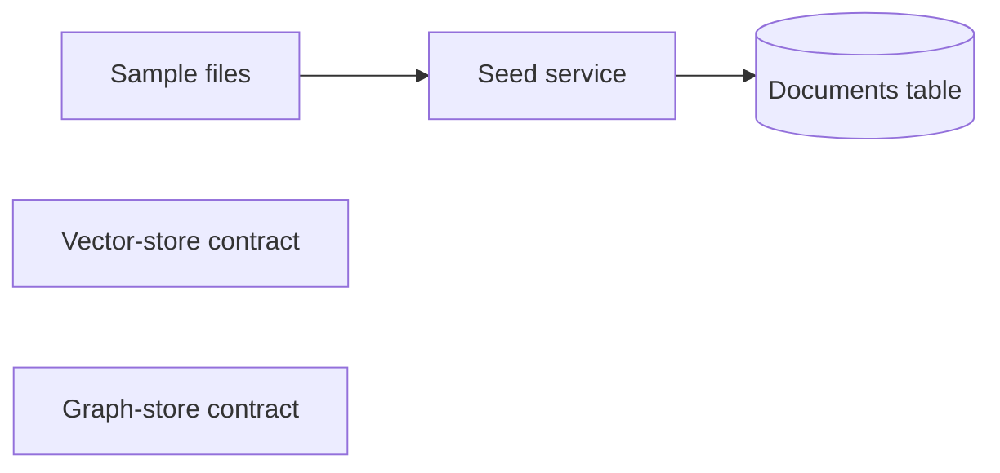
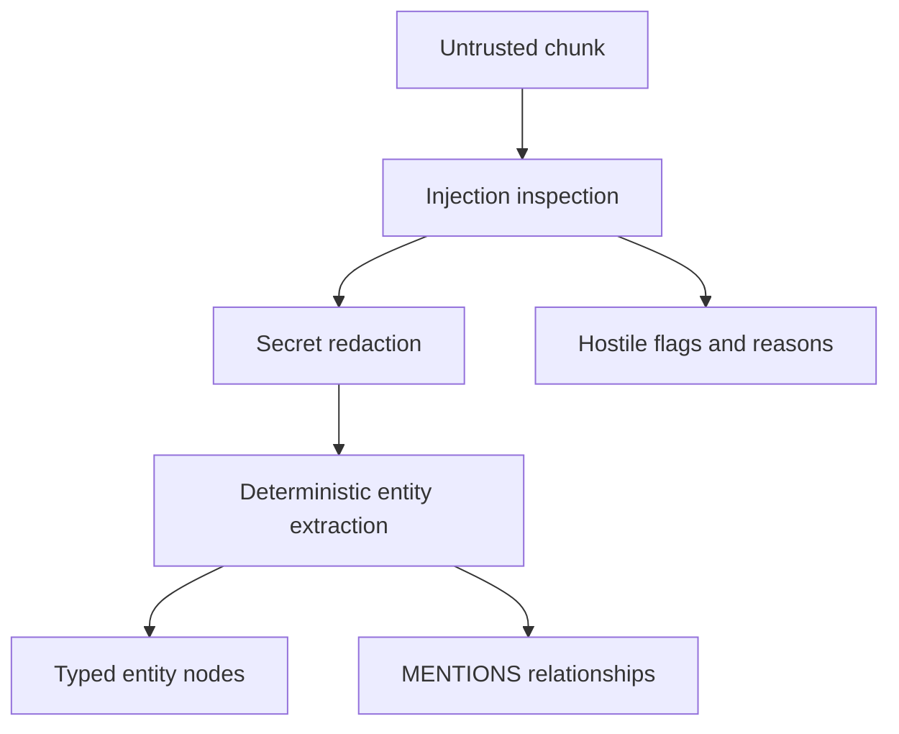
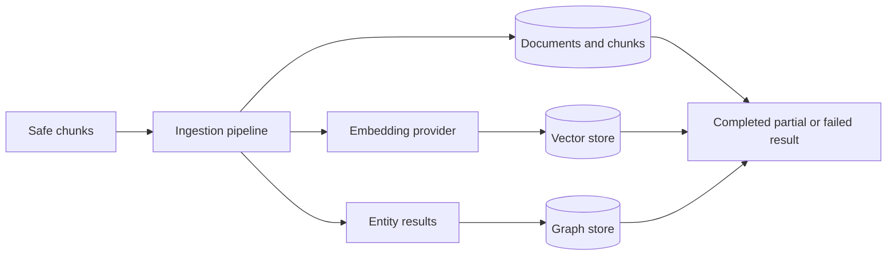
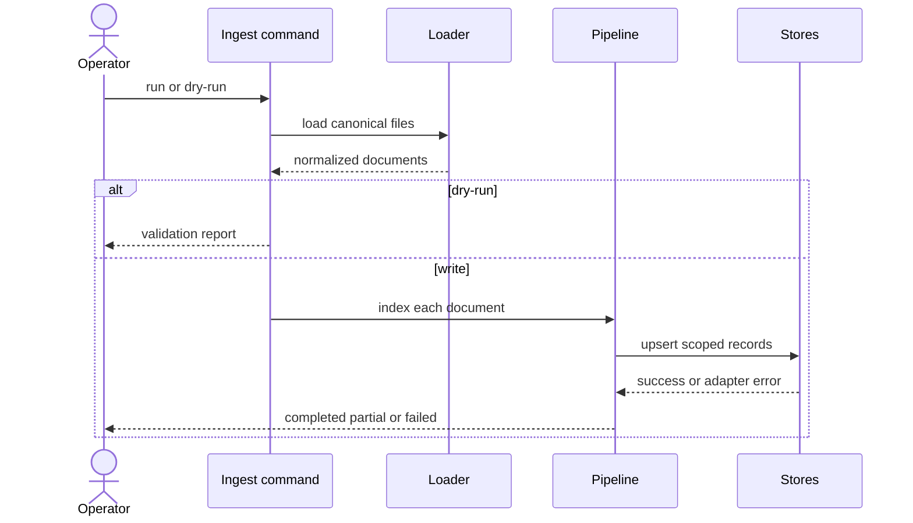

# Phase 5 — Project System Design Evolution

## Starting point

At the beginning of Phase 5, documents could be seeded into relational storage,
but there was no reusable path from a file to chunks, embeddings, or graph data.

## P5-1 — Validated loading and chunking

The first step creates a single safe entrance for Markdown, text, and PDF. Size,
encoding, type, and extracted content are validated before deterministic chunks
are created with source, page, position, and stable identity metadata.

## P5-2 — Guardrail-first knowledge extraction

Each chunk is treated as untrusted before extraction. The system flags hostile
phrases, redacts recognizable secrets, and uses fixed rules to identify known
enterprise entities. It never asks document text what action to perform.

## P5-3 — Coordinated multi-store indexing

One tenant-scoped coordinator writes the durable record first, then updates the
replaceable vector and graph adapters. Stable IDs and upserts make reruns safe.
An existing Phase 2 document with the same tenant and source is reused rather
than duplicated. Adapter errors produce an explicit partial result.

## P5-4 — Repeatable operator workflow

The final step wraps the pipeline in a module command. Dry-run mode validates
and reports without writing. Normal mode uses configured adapters, which default
to deterministic local implementations.

## End-of-phase design qualities

- Deterministic and offline by default.
- Tenant identity is part of every persisted/indexed identifier.
- Unsafe text remains inert data and carries an audit-friendly flag.
- Repeated execution does not multiply records.
- External vector/graph adapters can replace memory implementations without
  changing the ingestion workflow.
