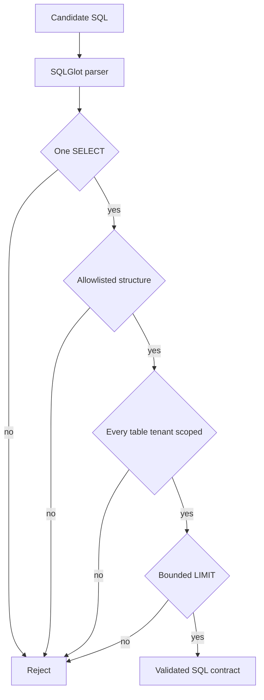
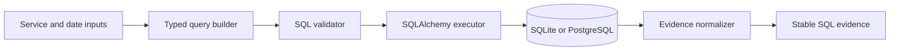
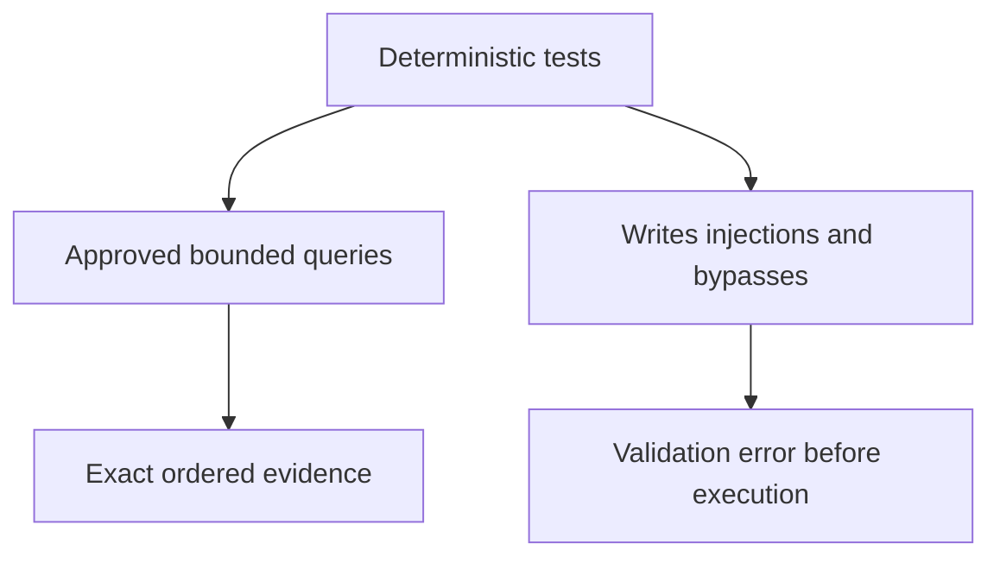
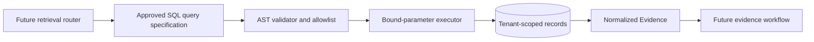

# Phase 6 — Project System Design Evolution

## Starting point

At the beginning of Phase 6, enterprise records and tenant-aware repositories
already existed. There was no retrieval boundary that could safely accept a SQL
query shape and return normalized evidence.

## P6-1 — A structural SQL security gate

The first step introduces an AST-based validator. It accepts only one bounded,
tenant-scoped `SELECT` over explicitly approved tables and columns. Dangerous or
ambiguous structures stop before execution.

## P6-2 — Parameterized templates and shared evidence

The second step adds a typed incident query. User-controlled values never enter
the SQL string. SQLAlchemy binds the tenant, service name, and half-open date
range. Returned rows become the shared `Evidence` contract.

The half-open interval is `started_at <= incident time < ended_at`. Adjacent
reporting periods therefore meet at one boundary without counting an incident
twice.

## P6-3 — Proving the boundary

The final subtask verifies both correct answers and rejected attacks. The tests
cover exact date boundaries, canonical Payments API incidents, tenant
isolation, hostile parameter values, empty results, stable evidence IDs,
deterministic ordering, result limits, and secret-redacted failures.

## End-of-phase design

End-of-phase qualities:

- Read-only by construction, not merely by prompt instruction.
- Tenant scope is validated and injected by the executor.
- Query values remain separate from SQL syntax.
- Results are deterministic, bounded, and citation-ready.
- SQLite tests the same contract that can sit in front of configured relational
  infrastructure later.
