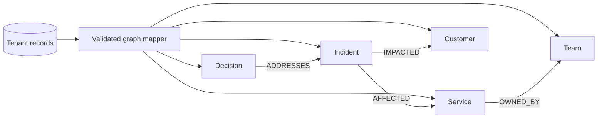
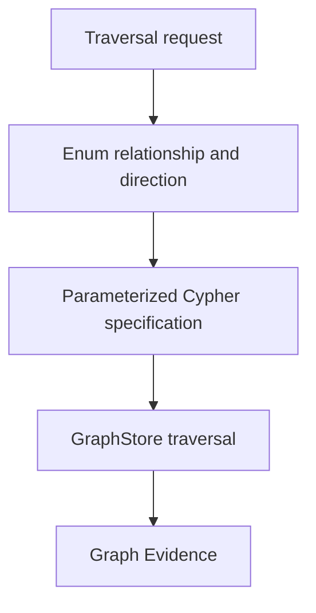
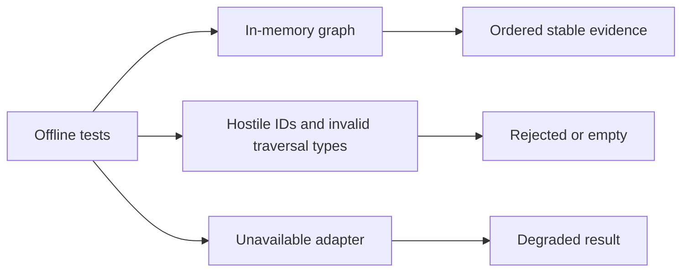
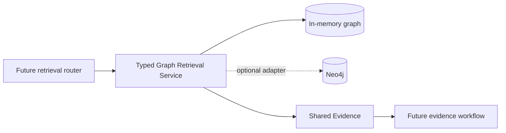

# Phase 7 — Project System Design Evolution

## Starting point

Phase 4 supplied generic graph adapters, but the application did not yet know
how enterprise records should become a business graph or which traversals were
safe to expose.

## P7-1 — Typed enterprise graph

Stable node and edge IDs plus upserts make repeated seeding idempotent. Missing
references stop the mapping instead of producing imaginary nodes.

## P7-2 — Typed read-only traversals

The Cypher shape is fixed. Tenant, node, service, date, and limit values remain
parameters. Customer-impact traversal uses a half-open date range, ownership is
one bounded hop, and expansion accepts only allowlisted relationships.

## P7-3 — Safety and degradation proof

## End-of-phase design

Phase 7 ends with deterministic graph construction, tenant-safe traversal,
parameterized query visibility, shared evidence, and explicit degradation.
