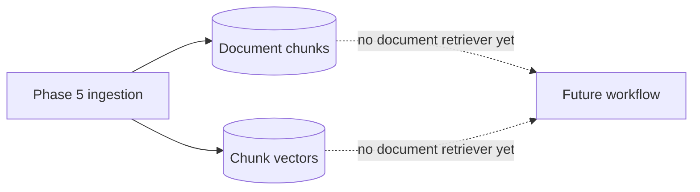
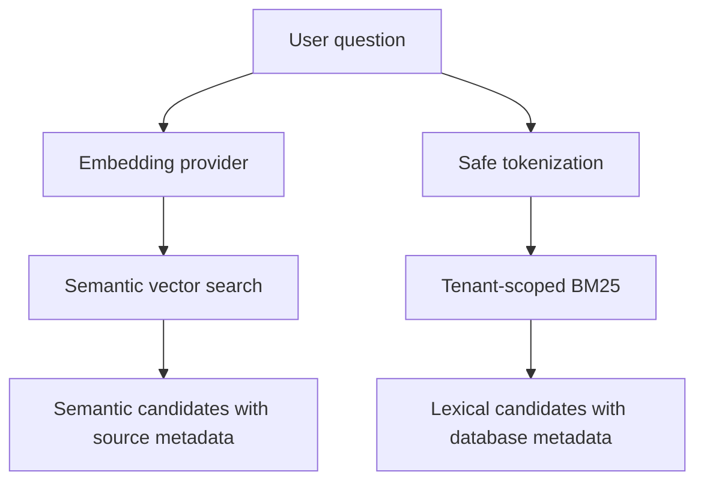
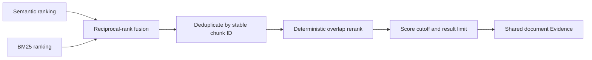
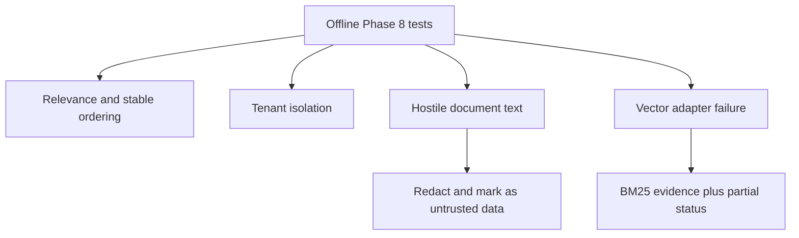
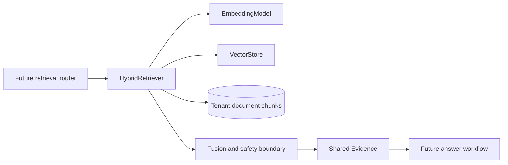

# Phase 8 — Project System Design Evolution

## Starting point

Phase 5 already split documents into safe chunks and stored them in the
relational database and vector store. At the start of Phase 8, the application
had storage but no unified way to retrieve and rank those chunks.

## P8-1 — Two complementary retrieval paths

Semantic search recognizes similar meaning. BM25 rewards discriminating word
matches using document frequency and length normalization. Both paths are
bounded and deterministic with the default in-memory providers.

## P8-2 — Fusion, reranking, and evidence

Reciprocal-rank fusion combines positions rather than incompatible raw score
scales. A chunk found by both methods gains support, while stable chunk IDs
prevent duplicate citations. The final score stays in the shared zero-to-one
Evidence range.

## P8-3 — Isolation, hostile content, and failure proof

Tests prove relevance, deduplication, stable evidence identity, bounds, source
metadata, isolation, secret redaction, and truthful adapter degradation without
network access.

## End-of-phase design

Phase 8 ends with one provider-neutral service that can find document evidence
through meaning and keywords, explain which channels found each passage, and
degrade safely without fabricating results.
