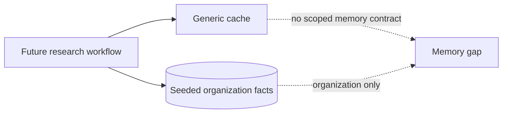
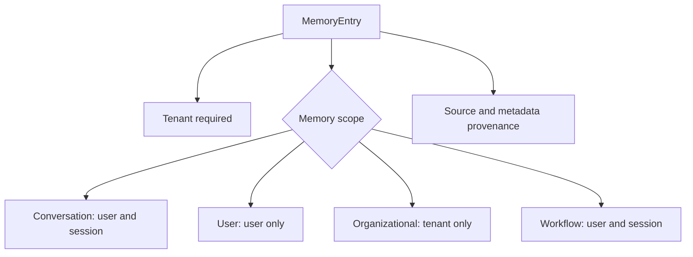
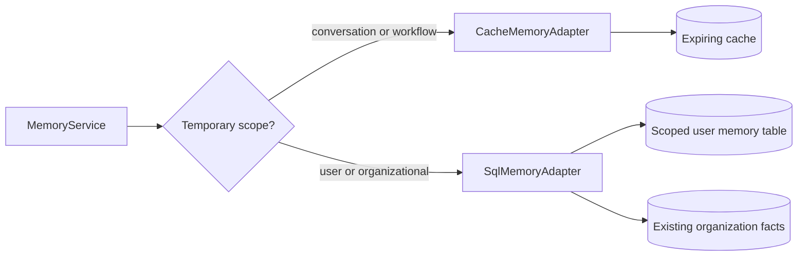
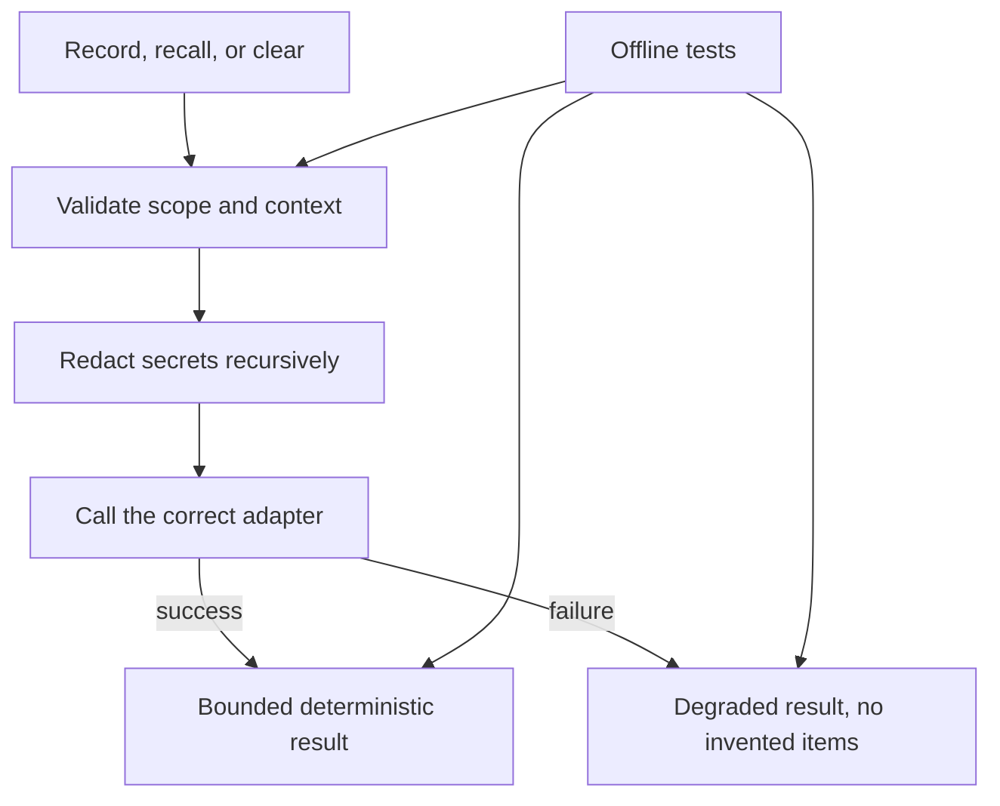
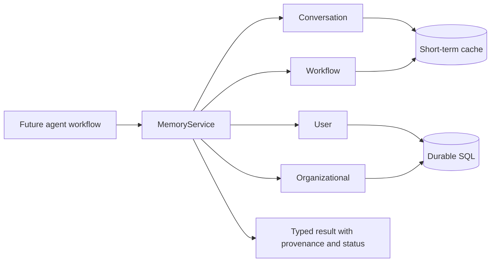

# Phase 9 — Project System Design Evolution

## Starting point

Phase 4 supplied a cache contract and Phase 2 supplied organizational facts,
but the application did not yet have one service for four isolated scopes.

## P9-1 — Explicit memory contracts

The first step names the scopes and makes their required ownership part of the
validated contract.

Invalid combinations are rejected before reaching an adapter. For example,
organizational memory cannot carry a user or session owner.

## P9-2 — Separate short-term and durable adapters

The service chooses storage from the scope. Callers never need to know whether
the local implementation is in-memory/SQLite or the optional Redis/PostgreSQL
production pairing.

## P9-3 — Safe operations and isolation proofs

Tests cover tenant, user, session, and scope isolation; stable upserts; bounded
recall; provenance; exact clearing; secret redaction; and adapter failure.

## End-of-phase design

The final boundary is deliberately independent from retrieval. Memory can help
shape a workflow, but evidence remains the source for factual claims.

