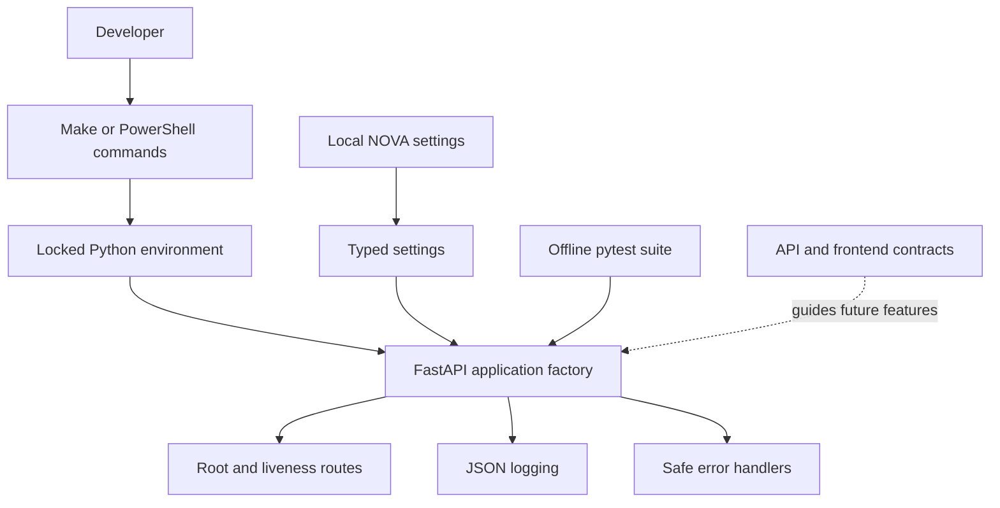
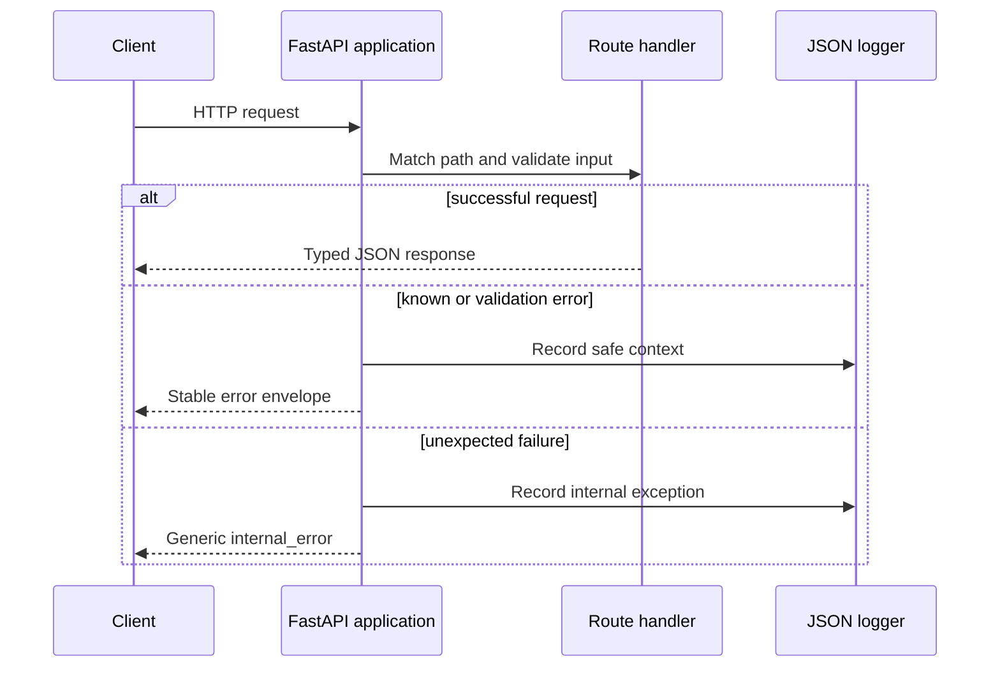

# Phase 1 Explained for an Interview Board

## My opening explanation

NovaEnterprise will eventually answer complex company questions using documents,
exact business records, and relationships between customers, incidents, services,
and teams. Phase 1 does not build that intelligence yet. It builds the dependable
foundation that every later capability will use.

I describe Phase 1 as preparing an airport before adding aircraft and routes. We
created shared operating instructions, a small control building, safety checks,
and an agreement describing how future passengers will interact with the system.
That order prevents every later team from inventing incompatible foundations.

All four Phase 1 tasks are implemented and verified. The application currently
has a thin web-service shell, not the complete research platform.

## What we built

### 1. A repeatable workspace

`pyproject.toml` is the authoritative Python project definition. It declares
Python 3.12, the runtime libraries, development tools, build system, pytest
settings, and Ruff quality rules. `uv.lock` freezes resolved package versions so
different machines can reproduce the environment. `requirements.txt` provides a
familiar pip entry point.

`.env.example` lists safe configuration names without containing credentials.
The `Makefile` provides short commands for setup, running, testing, linting, and
format checking. Windows contributors without Make can use the equivalent
PowerShell commands documented in `README.md`.

Why this matters: contributors no longer need personal setup instructions. The
same declared environment and commands reduce “works on my machine” failures.

### 2. A small FastAPI runtime shell

`backend/app/main.py` contains `create_app()`, the application factory. An
application factory is a controlled assembly point: it creates FastAPI, loads
settings, configures logging, installs safe error handlers, and registers routes.
Tests can create fresh application instances without starting a real server.

The Phase 1 service exposes:

- `GET /` for service name, availability, and version;
- `GET /health/live` to confirm that the process is alive;
- `/openapi.json` and `/docs`, generated by FastAPI from implemented routes.

These are foundation endpoints. Research, document, graph, authentication, and
database features belong to later phases.

### 3. Central settings

`backend/app/core/config.py` defines one typed `Settings` object. Environment
variables use the `NOVA_` prefix, such as `NOVA_LOG_LEVEL`. Invalid log levels or
API prefixes are rejected early. `get_settings()` caches one validated object per
process so the application does not repeatedly interpret configuration.

Why this matters: future business logic can request configuration from one place
instead of reading environment variables throughout the codebase.

### 4. Structured logging

`backend/app/core/logging.py` formats every log entry as JSON. Each line includes
a timestamp, severity, logger name, message, and optional context fields.

A normal person reads a sentence; monitoring software reads predictable fields.
JSON logs support both. Later phases can add request IDs, workflow IDs, and timing
without changing the logging foundation.

### 5. Safe, consistent errors

`backend/app/core/exceptions.py` creates one public error shape. Expected
application errors carry a safe code and message. Validation errors explain which
input failed. Unexpected exceptions return a generic `internal_error` response
while the real exception is written to server logs.

This separation is important: users get a stable explanation without receiving
stack traces, passwords, database details, or internal implementation data.

### 6. An offline test safety net

The `tests/` folder contains 12 tests for settings, routes, OpenAPI, logging, and
error behavior. The shared fixture sets deterministic test configuration and
blocks accidental external network access. FastAPI's in-process test client means
the suite needs no running server, API key, database, container, or cloud service.

Ruff checks code quality and formatting. At Phase 1 completion, all 12 tests,
lint, formatting, compilation, and lock consistency pass.

### 7. A written frontend-backend agreement

`docs/API_CONTRACT.md` records the current endpoints and the baseline promised to
later research and browse APIs. `docs/FRONTEND_ASSUMPTIONS.md` explains polling,
statuses, citations, roles, errors, accessibility, and degraded states.

The documents clearly label later routes as planned. A written contract lets the
frontend and backend evolve independently without guessing field names, status
codes, or error formats.

## How the pieces work together

For a request, the runtime path is:

## Why the dependency order reduced risk

P1-1 established the environment and commands first. P1-2, P1-3, and P1-4 could
then use the same conventions while remaining mostly independent:

- the runtime team built the application shell;
- the test work verified it through stable public behavior; and
- the contract work documented what exists now and what later teams may rely on.

This avoids branches inventing different dependencies, commands, ports, or error
formats and discovering the conflict only during integration.

## What Phase 1 deliberately does not include

Phase 1 does not implement persistence, authentication, rate limiting, document
ingestion, vector search, SQL retrieval, graph traversal, memory, LangGraph
workflows, the frontend, evaluation, or deployment.

It also does not create Docker images or a Docker network. Those are Phase 16
delivery tasks. The current backend runs as a local Python process on port 8001
only when a developer starts it.

## Short interview answers

### Why build foundations before AI features?

AI features still need ordinary engineering discipline: predictable startup,
configuration, errors, logs, tests, and interfaces. Establishing those first
reduces expensive rework when retrieval and agent components begin interacting.

### Why use an application factory?

It provides one controlled assembly point and lets tests create isolated app
instances. Future environments can provide different settings without changing
business logic.

### Why insist on offline tests?

Offline tests are fast, repeatable, and independent of paid or unavailable
services. They prove foundation behavior without network uncertainty.

### Why JSON logs?

They are readable by people and searchable by software. Context can be added as
fields rather than buried in inconsistent sentences.

### Is Docker part of Phase 1?

No. Phase 1 proves the local process and its boundaries. Packaging those mature
boundaries into containers is intentionally deferred to Phase 16.

## Closing statement

Phase 1 transformed NovaEnterprise from a greeting-only Python scaffold into a
repeatable, testable, observable, and contract-driven FastAPI foundation. It is
small by design. Its success is that later teams now have one reliable place to
attach capabilities and one honest way to verify and explain them.
