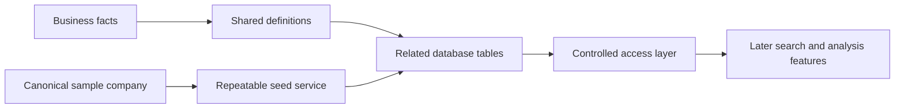
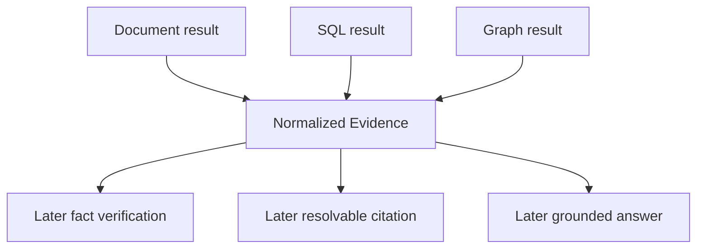
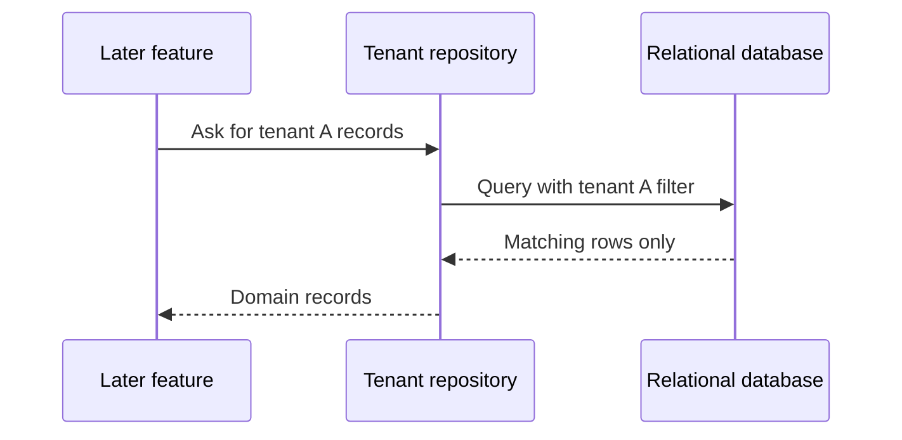
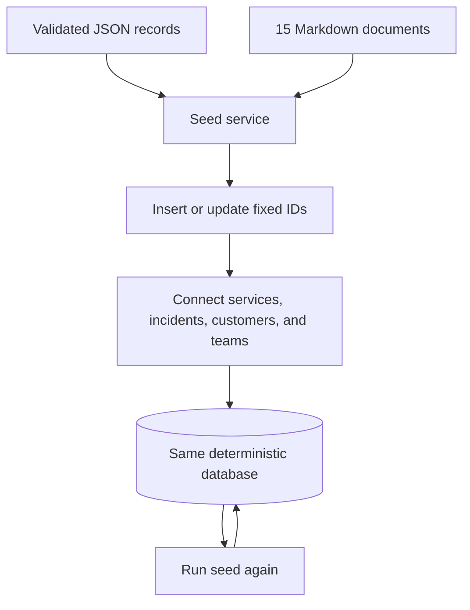

# Phase 2 Explained for an Interview Board

## My opening explanation

Phase 1 gave NovaEnterprise a reliable web-service foundation. Phase 2 gives
the application a reliable memory for business facts. It defines what a team,
customer, incident, decision, document, and piece of evidence look like, then
provides one controlled way to store and retrieve those records.

An everyday comparison is a company archive. Phase 1 built the reception desk
and operating procedures. Phase 2 designed the forms, filing cabinets, access
rules, and a realistic training archive. Later phases can now build search and
analysis without inventing different meanings for the same information.

## The business problem Phase 2 solves

NovaEnterprise must eventually answer questions such as:

> Which customers were impacted by the Payments API last quarter, which
> incidents occurred, which teams own those services, and what decisions were
> taken to prevent recurrence?

The facts needed for that answer are related but different. Customers are linked
to incidents, incidents belong to services, services have owner teams, and
decisions explain follow-up action. If every feature stored those facts in its
own format, the final answer could be inconsistent or impossible to verify.

Phase 2 creates one dependable information foundation:

## What was built

### 1. Shared definitions

The Pydantic schemas are the application's vocabulary. They define allowed
values such as incident severity, customer tier, ticket priority, and research
status. They also reject unknown fields instead of silently accepting mistakes.

For example, an incident has a service, title, explanation, root cause,
severity, status, start time, optional resolution time, and a list of affected
customers. Every later component can rely on that meaning.

### 2. One evidence envelope

Different search methods will arrive in later phases: document search, exact
database queries, and relationship traversal. Their raw results look different.
The normalized `Evidence` contract gives them one common envelope.

Each evidence item includes:

- a stable ID so the same item can be recognized again;
- a source type, such as document, SQL, or graph;
- a source record ID and locator so a citation can be resolved;
- the supporting content;
- optional title, relevance score, and query; and
- source metadata and the collection time.

Phase 2 defines this agreement but does not yet implement the three retrieval
engines or generate answers.

### 3. Relational data model

SQLAlchemy models translate the business vocabulary into related database
tables. They cover enterprise records, documents and future chunks, research
sessions and workflow events, organizational memory, and audit records.

Important relationships are stored directly. An employee belongs to a team, a
service has an owner team, an incident belongs to a service, and an incident can
affect several customers. Decisions can refer to the incident and service that
motivated them.

Every business table also carries a `tenant_id`. A tenant is one organization
using the platform. That field makes organizational separation part of the data
design from the beginning instead of an afterthought.

### 4. Database setup and migrations

The engine and session helpers provide one place to open and close database
work. Local development uses a SQLite file by default, while
`NOVA_DATABASE_URL` can point to another supported database.

Alembic records the initial schema as a migration. A migration is a numbered,
reviewable database change: it lets environments move from one known version to
the next in a repeatable way.

The project also contains PostgreSQL row-level-security policy SQL. In a
PostgreSQL deployment, those policies are intended to add database-enforced
tenant filtering. SQLite does **not** enforce those policies, so local isolation
currently depends on the repository layer. The documentation does not claim
otherwise.

### 5. Repository layer

Repositories act like librarians between application features and database
tables. A service asks a repository for records; it does not scatter SQL through
web routes or business logic.

The common repository automatically applies the selected tenant to reads,
counts, and lists, validates tenant identity on writes, and limits pagination.
Specialized repositories add meaningful operations such as:

- find a service by name;
- find incidents for a service in a date range;
- load the customers impacted by those incidents;
- find decisions for a service;
- load a document and its ordered chunks;
- list a user's research sessions and their ordered events; and
- inspect audit history for a resource.

### 6. Canonical sample company

The `sample_data/` folder contains a fixed demonstration company:

| Information | Count |
|---|---:|
| Teams | 6 |
| Employees | 20 |
| Services | 8 |
| Customers | 10 |
| Incidents | 12 |
| Decisions | 8 |
| Projects | 6 |
| Tickets | 15 |
| Organizational memory facts | 3 |
| Markdown documents | 15 |

The records include the Payments API story required by the project problem:
incidents, affected customers, service ownership, decisions, postmortems, ADRs,
a runbook, and a quarterly reliability summary.

One vendor document deliberately contains hostile instructions. The seed marks
that document as untrusted. Phase 2 stores the warning; later security and
ingestion phases decide how such content is processed. The application must
always treat the text as data, never as an instruction.

### 7. Repeatable seeding

The seed service validates every JSON file through the shared schemas, loads
records in dependency order, connects the relationships, hashes document
content, and commits the complete dataset.

It uses fixed IDs and merge behavior. Running it a second time updates the same
records rather than creating duplicates. This property is called idempotency.
It lets a developer rebuild the same demo safely and makes tests predictable.

## How Phase 2 supports the canonical question

Phase 2 does not answer the question yet, but it makes the required facts
consistent and queryable:

| Question part | Phase 2 foundation |
|---|---|
| Which incidents occurred? | Dated incident records linked to Payments API |
| Which customers were affected? | Incident-to-customer relationship table |
| Which team owns the service? | Service-to-owner-team relationship |
| What was decided? | Decision records plus postmortem and ADR documents |
| Can the answer cite a source? | Stable evidence ID, source ID, and locator contract |

Later SQL, graph, and document-retrieval phases will read this foundation. Phase
2 deliberately does not pre-empt those responsibilities.

## What Phase 2 deliberately does not include

Phase 2 does not add authentication, authorization middleware, public browse
endpoints, document chunking or indexing, vector search, graph storage, safe SQL
generation, agent workflows, answer generation, a frontend, or Docker services.

The database tables for research sessions, events, chunks, and audit logs are
forward-compatible storage shapes. Their later services are not being claimed
as complete here.

## Short interview answers

### Why define schemas before building search?

Search is only trustworthy when every component agrees on the meaning of the
records and results. Shared schemas prevent drift and catch malformed data early.

### Why put database access behind repositories?

It keeps storage details in one layer, applies tenant filtering consistently,
and makes business services easier to test or change.

### Why support both SQLite and PostgreSQL?

SQLite gives developers a simple local setup. PostgreSQL is the production-style
path and supports stronger controls such as row-level security. The application
keeps that difference explicit.

### What does idempotent seeding buy us?

The same command always produces the same demonstration state. It can be rerun
after a test or migration without multiplying records.

### Is the hostile vendor note a security feature?

It is a security test fixture, not a complete defense. Phase 2 flags it as
untrusted; later phases implement ingestion and prompt-injection safeguards.

## Closing statement

Phase 2 turns NovaEnterprise's design vocabulary into a concrete, tenant-aware,
repeatable information layer. The system now has shared contracts, related
tables, controlled data access, migration history, and a canonical demo company.
That gives future retrieval and agent features one trustworthy foundation rather
than several incompatible sources of truth.
