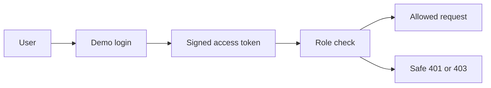
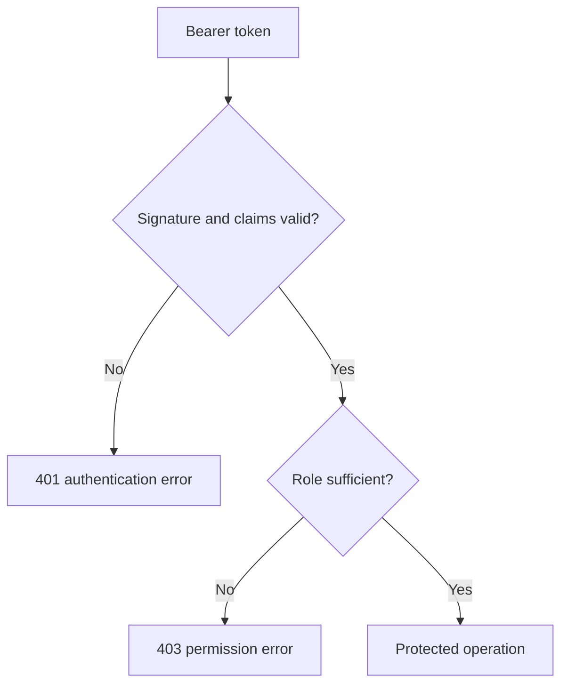
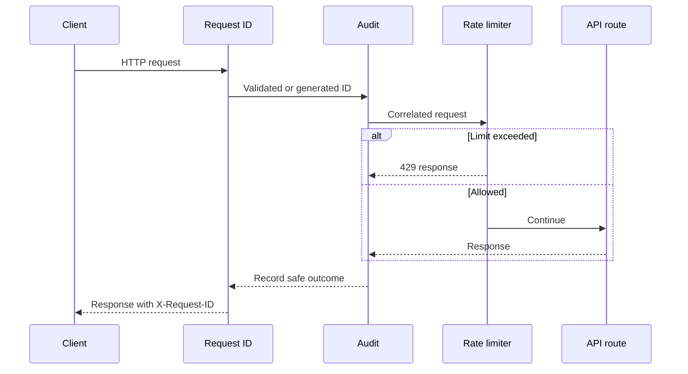
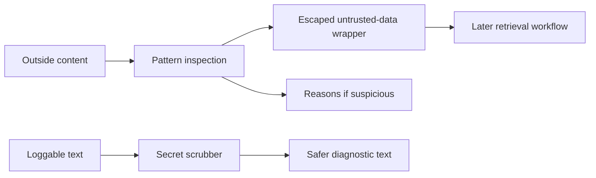
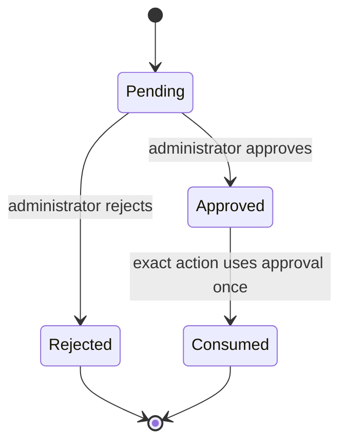

# Phase 3 Explained: Identity, Middleware, and Safeguards

## The simple story

At the end of Phase 2, NovaEnterprise had organized information and a reliable
database foundation. It still treated every caller as an unknown visitor. Phase
3 adds the security desk, visitor badge, traffic controller, activity register,
content inspector, and approval counter.

The easiest comparison is entering a controlled office:

- login proves who you are;
- the token is your signed visitor badge;
- your role says which rooms you may enter;
- the request ID is the tracking number on every interaction;
- rate limiting prevents one visitor from overwhelming the reception desk;
- auditing records what happened without recording passwords or request bodies;
- guardrails treat outside documents as reference material, not commands; and
- approvals require an administrator to authorize a destructive action once.

## P3-1: identity and roles

The system recognizes three roles. A viewer can read, an analyst can perform
research work, and an administrator can perform privileged operations. Higher
roles inherit lower-role access.

The browser sends a signed token with a request. NovaEnterprise verifies the
signature, expiry time, issuer, intended audience, user, tenant, and role. A
changed or expired token is rejected. Routes use one central `require_role`
check, so permission rules are not copied differently across many files.

This is an offline demonstration identity system. Production deliberately
rejects the built-in signing secret, and demo login is unavailable in staging
and production.

## P3-2: offline demo login

Local developers and interviewers can log in as `viewer`, `analyst`, or
`admin`, using the documented local-only passwords. Login returns a short-lived
signed token and a safe user description. Passwords are never returned.

The `/api/v1/auth/me` endpoint proves that the token can be read back into the
same user identity. The API prefix and tenant come from configuration, so a
configured installation is not silently forced to use the demo defaults.

## P3-3: the request safety corridor

Every request passes through three controls in a deliberate order.

The request ID lets support connect a user-visible error with the matching log.
Unsafe IDs containing spaces or control-like characters are replaced. Even an
unexpected server error carries the tracking ID.

The local rate limiter counts requests by client address during a sixty-second
window. The audit trail records the request ID, method, path, response status,
actor, tenant, and time. It does not store passwords, bearer tokens, query
strings, or request bodies. Its memory is bounded, so it cannot grow forever.

Both components are intentionally local and in-process in Phase 3. A later
phase can replace them with shared Redis and durable audit persistence for a
multi-instance deployment.

## P3-4: unsafe content and approvals

Enterprise documents are useful evidence, but a document can contain text such
as “ignore previous instructions.” Phase 3 scans for common instruction
override, prompt-exposure, and credential-exfiltration patterns. It wraps all
outside text in an escaped, clearly marked untrusted-data boundary. Flagging is
not the same as deleting: later retrieval can retain the evidence while refusing
to obey it.

Destructive actions use a separate approval service. An action is tied to one
tenant, one action name, and one resource. Only an administrator can approve or
reject it. An approval can be consumed exactly once, so it cannot authorize a
different document or be replayed.

## What Phase 3 does not claim

It does not provide a production identity provider, shared Redis limiter,
durable approval database, new research API, document deletion endpoint, or
Docker network. Those later components will use the security boundaries built
here.

## Interview summary

Phase 3 changes NovaEnterprise from a database-backed service that trusts every
caller into a service with a controlled front door. It proves identity with a
signed badge, checks roles centrally, tracks and limits requests, records safe
audit facts, treats retrieved content as untrusted data, removes common secrets
from text, and makes destructive approval narrow and one-use. The result is a
testable security foundation without pretending the local demo is a complete
production security platform.
