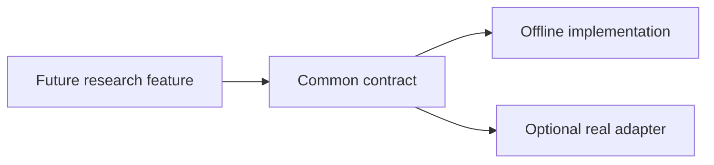
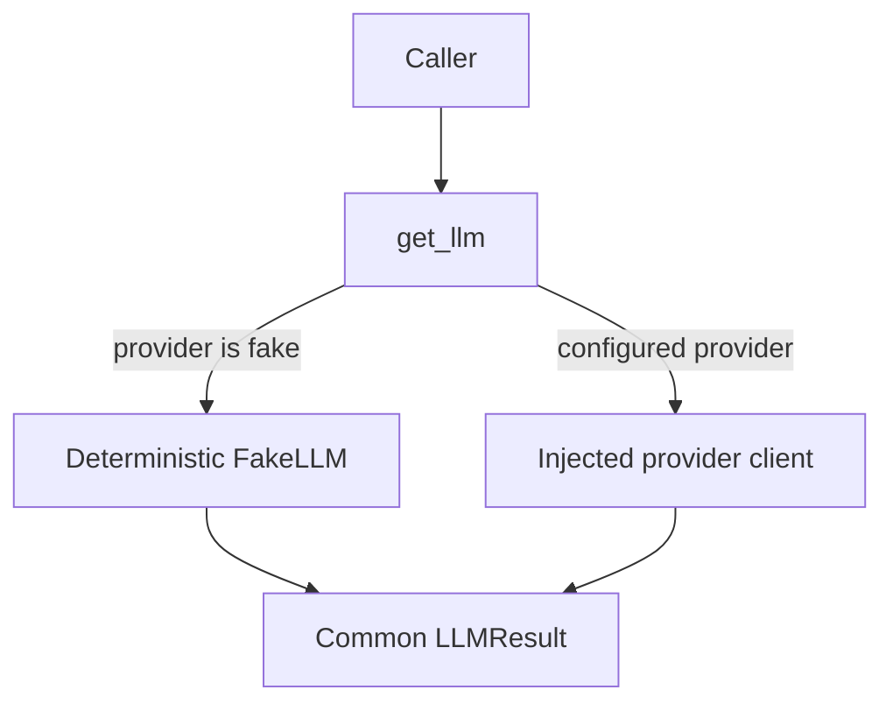
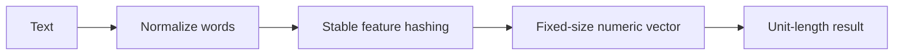
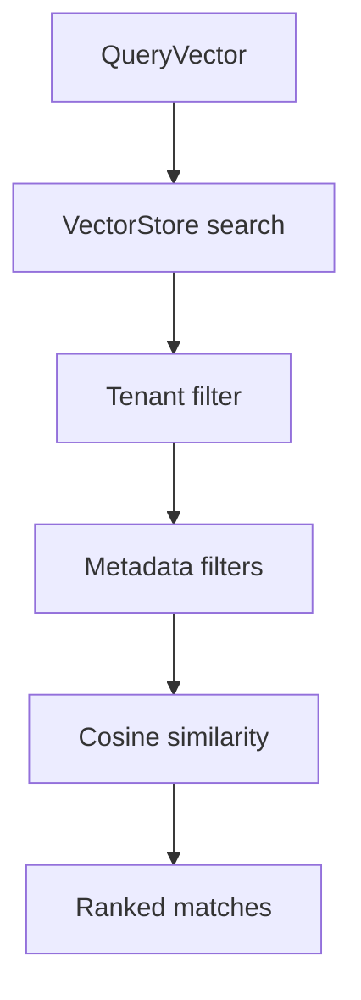
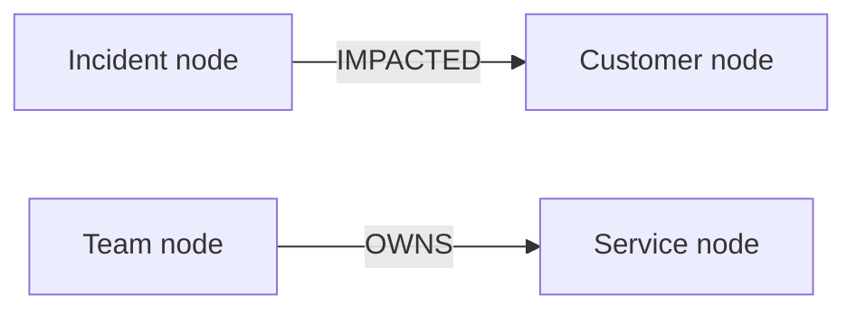
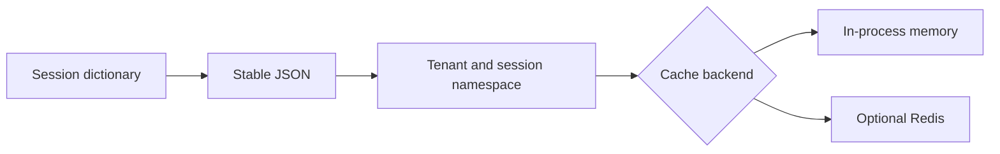

# Phase 4 Explained: Provider and Storage Abstractions

## The simple story

Phase 4 makes NovaEnterprise replaceable by design. Instead of teaching the
application one specific AI company, vector database, graph database, or cache,
we teach it a small common language for each capability.

Think of a universal electrical socket. A lamp asks for electricity; it does
not need to know which power station generated it. In the same way, later
research code asks for text generation, embeddings, vector search, graph
connections, or cached session state without knowing which vendor supplies it.

The offline implementations are the default. They need no API key, Docker
container, network, or paid service, which keeps demonstrations and tests
repeatable.

## P4-1: replaceable language models

All language models expose one operation: receive a prompt and optional system
instruction, then return content plus provider, model, and token-count metadata.

The fake model hashes normalized input and returns the same safe placeholder for
the same request every time. It is not pretending to be intelligent; its job is
to let later workflow logic run predictably. Eight real-provider names can be
selected, but they require an explicitly configured client instead of secretly
making a network call.

## P4-2: replaceable embeddings

An embedding converts text into a list of numbers that represents its features.
The fake embedding model uses stable feature hashing, always produces the
configured number of values, and normalizes the result to unit length.

The same text gets the same vector on every machine. Empty batches remain empty,
and even empty text has a valid deterministic vector. A real embedding client
can later replace the fake model through the same contract.

## P4-3: vector storage

Vector storage answers “which stored items are numerically closest to this
query?” The memory adapter stores vectors in the Python process and ranks them
with cosine similarity. It supports metadata filters, dimension checks,
deletion, stable ordering, and strict tenant isolation.

The optional Qdrant adapter translates the same calls into Qdrant point,
filter, query, and deletion requests. Point IDs are derived deterministically
from tenant plus record ID. Tenant filtering is applied in the database request
and checked again on returned payloads.

## P4-4: graph storage

Graph storage represents connected facts, such as an incident impacting a
customer. Nodes are the things; edges are the named relationships.

The in-memory graph supports outgoing, incoming, and both-direction neighbor
lookups. It refuses cross-tenant data and edges whose endpoints do not exist.

The Neo4j adapter expresses the same typed operations as parameterized Cypher.
Tenant IDs and values remain parameters. Labels and relationship types cannot
be parameters in Cypher, so Phase 4 accepts only safe identifier characters.
Properties cannot overwrite protected IDs or tenant fields.

## P4-5: cache and session state

A cache stores short-lived values so work does not need to be repeated. The
memory cache is thread-safe and supports expiration and deletion. The Redis
adapter exposes the same byte-oriented behavior when a Redis client is present.

The session facade converts a dictionary to stable JSON and gives every value a
tenant-aware, collision-resistant key.

Expiration is part of the contract, not an accidental backend detail.

## What is running now

By default, everything runs inside one Python process:

- fake language model;
- fake embeddings;
- memory vector store;
- memory graph store; and
- memory cache.

Qdrant, Neo4j, Redis, and real AI clients are adapters, not running services.
Selecting one without its optional package produces a clear configuration
error.

## Interview summary

Phase 4 separates what the application needs from who provides it. Future code
can use one stable interface while configuration chooses a deterministic local
implementation or a real service. Tenant isolation, validation, expiration,
safe query construction, and predictable failures live inside the adapters.
That reduces vendor lock-in and lets the complete learning path work offline.
